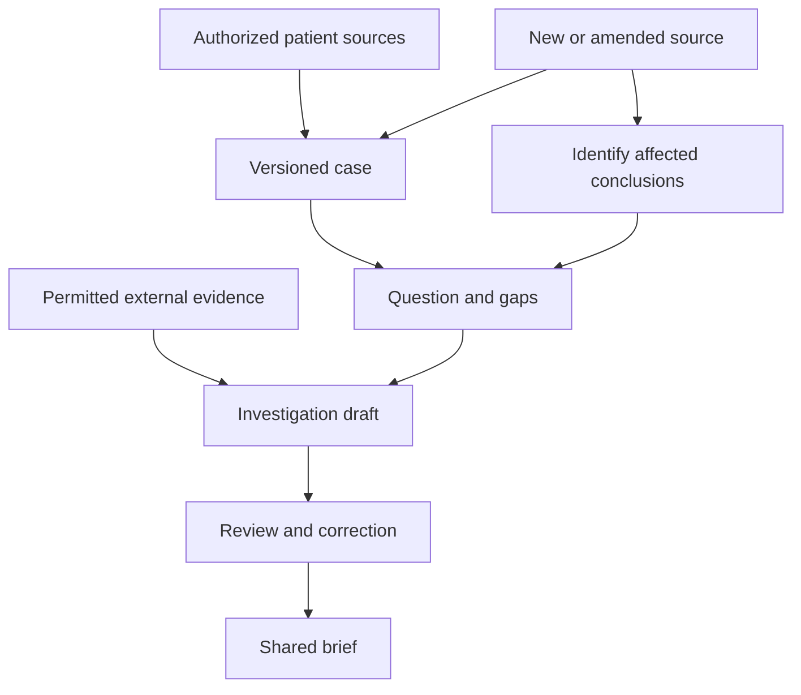

# Open Intelligence — a plan from first principles

**Public project foundation · Updated 31 October 2026 · Open Intelligence**

Original source checks: 29 October 2026. Source terms and guidance must be rechecked for each integration or deployment decision.

## Decision and status

Keep the full ambition: an accessible, AI-native operating environment for understanding a person's cancer, investigating unanswered questions, and coordinating evidence-informed review over time. Reorganize execution around a complete clinical workflow rather than an expanding list of repositories or screens.

**Recommended first product:** a shared oncology case-investigation workspace that prepares a reviewable case brief, connects one unresolved question to appropriate evidence, and updates that investigation when a new or corrected record arrives.

**Next decisive demonstration:** a second time point. An amended report must immediately mark affected conclusions as needing review, preserve the previous reviewed version, reopen the relevant question, and present a proposed change that a reviewer can inspect. Receipt of a source and acceptance of a clinical interpretation are distinct events.

The architecture and milestones below are proposed. The initial repository contains planning documents and contributor instructions; it does not contain an implemented or clinically validated application. The backend, partner, jurisdiction, cohort, commercial model, deployment, and distribution license remain open decisions.

## 1. What the earlier work taught us

The original brief identified five enduring requirements: a complete longitudinal record, oncology-specific reasoning, research-grounded agents, ordinary-language patient/physician use, and continuous investigation. Those remain the direction.

Earlier work outside this repository explored reusable resources, licensing, interface ideas, and component feasibility. Those artifacts are not included in this initial repository and do not establish implementation, release clearance, clinical usefulness, extraction performance, safety, demand, or willingness to pay here.

Our emphasis drifted toward which repositories could be reused and whether a demonstration could be packaged. Those questions matter, but they do not determine what should be built. The sequence should be:

**Clinical job → consequential failure → required evidence → workflow/data contract → implementation choice → evaluation → expansion.**

Use earlier research as input to component selection. Reuse earlier implementation artifacts only if they are separately reviewed and deliberately imported. A resource catalog is a set of alternatives, not a requirement to integrate every tool. Clearance depends on the exact artifact and intended use.

Sid Sijbrandij's account illustrates intensive data gathering, coordinated physicians/scientists and repeated investigation. The reusable lesson is the infrastructure and expert workflow. His public story is not a controlled comparison establishing that AI caused an outcome or that another patient should reproduce his treatments. [S1, S2]

## 2. The fundamental problem and product promise

The platform must help a patient and care team answer four recurring questions:

1. What does the available record actually support now?
2. What is missing, contradictory, uncertain or different from the last review?
3. Which unanswered question matters to the next clinical discussion, and what evidence could resolve it?
4. What changed after a new result, interpretation or publication, and who needs to review it?

Our proposed early promise is: **make a complex oncology case easier to reconstruct, inspect, question and update, while preserving the basis and limits of each conclusion.**

Long-term goals such as better personalized care and more accessible advanced research remain important. Early product claims should follow measured capabilities: fewer preparation steps, lower total review burden, better source traceability, more reliable correction handling and improved patient comprehension. Survival, therapeutic efficacy and individualized treatment benefit require different evidence.

The first success unit is a reviewed case investigation, not a chat answer. It has a patient/case scope, question, owner, available source set, cutoff date, supported claims, evidence assessments, unresolved items, review history and next action. Several investigations can use the same case without collapsing their different purposes or time points.

## 3. Choose a first workflow while preserving the platform

| Entry point | What it could prove | Main difficulty | Proposed decision |
|---|---|---|---|
| Patient-owned record coordination | Patients can gather records, see gaps and prepare questions | Acquisition burden and clinician adoption may dominate; records alone do not deliver the research promise | Preserve as an essential capability and a possible earlier market if evidence supports it |
| Clinician-supported consultation investigation | A patient, coordinator and clinician can use a shared case to prepare, investigate and update a review | Requires real reviewers, a defined clinical setting and measured review burden | **Recommended initial workflow** |
| Specialist molecular/tumor-board research | Deep biological context and evidence appraisal create value for complex cases | Specialist time, assay context, data access and stronger interpretation validation | Early design-partner path; enable as the foundation proves itself |

A full EHR replacement would add prescribing, billing, enterprise operations and integrations without proving the central investigation thesis. Build interfaces to those systems as justified by the chosen workflow. Own the coherent case and investigation experience.

**Provisional launch setting:** an adult oncology consultation, referral, second opinion or case-review service with an accountable oncology reviewer. Use one repeatable workflow and an initial cohort chosen with that partner. Use independently authored fictional cases for engineering, and do not let a synthetic example determine the market or imply a final disease scope.

**Daily operator hypothesis:** an oncology nurse, navigator, clinical research coordinator or clinician preparing the case. **Accountable interpreter:** an appropriately qualified treating or reviewing clinician. **Patient/caregiver role:** access and source coordination, attributed history, goals, questions, correction requests and understanding of the reviewed output. **Buyer hypothesis:** the organization operating the review workflow. None of these demand assumptions has yet been established.

Patients remain a co-designed audience from the beginning. Clinical review must not become an excuse to give them an opaque institutional dashboard. The same facts should support understandable patient explanations and more detailed professional review, with role-appropriate actions and visibility.

## 4. The minimum complete workflow

### Intake and coverage

Import a bounded set of authorized documents and structured results. Keep originals, document identity, versions, acquisition receipts and the reason each source may be used. Show requested, received, unreadable, unprocessed, reviewed and missing material. A complete picture is always relative to known sources and the question being considered.

Patient/case attachment must be explicit. Different names, institutions, specimens, tumors and dates must not silently merge. A wrong-patient import needs quarantine and a reversible correction path. A hash proves bytes match; it does not establish that the source is authentic, clinically correct or attached to the right person.

### Reconstruct and review

Extract proposed assertions with exact page/span/resource anchors. Preserve original wording, values and units. Show contradictions beside their sources. Let a reviewer confirm extraction, correct attribution or leave the matter unresolved. Verification of transcription is a different action from endorsement of a clinical interpretation.

### Investigate one question

An investigation begins with the actual known facts, missing inputs and a question whose answer could change the next discussion. It retrieves only permitted evidence, records why that evidence may or may not apply, and distinguishes observations, derived calculations, interpretations and hypotheses.

Bibliographic discovery is a separate step from reading and appraising evidence. An article title and DOI cannot support a claim that an intervention benefits this patient. A bibliography by itself does not establish a clinical research capability.

### Produce a shared brief

The brief should show the case snapshot and cutoff, changes since the last review, supporting patient sources, the question, evidence and applicability limits, unresolved disagreements, review status, responsible person and next task. The patient version should explain the same reviewed facts without increasing certainty. Patient goals and preferences should be attributed and date-stamped.

### Process the next result

When an amended or delayed result arrives, preserve both source versions, distinguish correction from a genuinely new specimen/time point, identify dependent claims, and mark affected outputs as needing review. Show what changed and why. Keep prior exports as historical snapshots with a supersession reference; do not silently rewrite the record of what was known earlier.

Between receipt and review, the previous reviewed snapshot remains inspectable as history and visibly flagged where its basis has changed. The proposed replacement appears separately. An export made during this interval must display its date, version and stale/review-pending status; it must not present the old conclusion as an unqualified current finding. Only the appropriate scoped review creates a new reviewed snapshot. Previously downloaded files cannot be silently recalled or rewritten.

A different assay or specimen is not automatically a correction of the old one. A new observation may coexist with the old result and raise a new question. The update workflow must handle both cases.

### The organizing workflow

Access policy applies to every step. An update schedules review of the affected work; it does not automatically prescribe an action or publish a new clinical conclusion.

## 5. Product invariants and meaning

| Principle | Required behavior |
|---|---|
| Source assertions and interpretation remain distinct | The system can show what a report says, what software extracted, what was calculated, and what a clinician concluded |
| Missingness is explicit | Negative, not reported, pending, indeterminate, not assessed and conflicting are different states |
| Time has several meanings | Preserve event/specimen time, report/finalization time, receipt time and the version known at review time; retain partial dates and uncertainty |
| Biological context persists | A finding remains linked to tumor, lesion, specimen, assay, method and reference context where applicable |
| Corrections propagate visibly | A revised source can invalidate dependent interpretations and briefs without erasing history |
| Evidence has scope | Study design, source reliability, patient applicability, authorization and freshness are separate dimensions |
| Review is scoped | Accepting extraction does not approve treatment or validate an assay; a reading-mode switch is not clinical authority |
| Permissions apply throughout | Source viewing, search, embeddings, model inputs, background jobs, exports and logs obey the same access and purpose rules |
| Ordinary-language interaction creates durable work | A useful conversation can create or update a question, correction request or review task rather than disappearing in chat history |
| Model outputs remain inspectable proposals | They cannot assign themselves authority, conceal missing support or execute clinical actions outside the defined workflow |

FHIR already provides useful concepts for clinically relevant versus issued observation times, missing values, resource versions and provenance. It does not automatically implement the complete product trust model. mCODE supplies oncology data-sharing patterns and explicitly does not require every possible data item to have been collected for each patient. [S3–S5]

## 6. Architecture: own the clinical meaning, reuse infrastructure

Start with a modular web application and API, a transactional relational database, protected object storage, a background worker and an established identity service. Keep module boundaries explicit so expensive or specialized processing can later run separately. Avoid a distributed microservice platform until operational needs justify it.

The durable data model needs the following objects:

| Object group | Purpose |
|---|---|
| Person, identity links and authority grants | Who the record concerns and who may access, contribute, review or delegate |
| Source artifact, version and receipt | Original evidence, origin, permitted use, custody and processing state |
| Assertion and clinical event | What is reported, when it concerns the patient, its uncertainty and its exact source |
| Tumor, lesion, specimen, assay and asset | The biological and technical context of a measurement or finding |
| Patient goal and preference | What the patient values, who recorded it and when it was confirmed |
| Question and hypothesis | The unresolved issue, alternatives, owner, evidence needed and status |
| Evidence item and applicability assessment | External support or contradiction, version, content rights and limits |
| Review decision and investigation snapshot | What was accepted, disputed or left open, by whom, using which source versions |
| Task, run and dependency link | Reproducible work, input/output versions, failure recovery and targeted invalidation |

Keep original source material, normalized assertions, derived interpretations and presentation/export layers separate. The current supported case view is a projection of versioned assertions and review decisions; it is not an editable paragraph that replaces its inputs.

**Standards boundaries:** use FHIR/mCODE where they match exchange requirements; retain the application model for questions, permissions, dependencies and review. Preserve modality-native identifiers and formats. Treat OMOP as a possible later analytical projection, not a requirement for operational case review. Store evidence relationships in ordinary tables initially; introduce a graph database only when a measured query workload or operational requirement warrants it.

**Backend choice:** compare an application-owned domain with FHIR adapters against Medplum using the same imports, source corrections, isolation, version recovery and export requirements. Add HAPI FHIR to the comparison only if partner interoperability requirements justify another full server candidate. An earlier Medplum probe outside this repository does not select the backend or establish dependency clearance here. Select on reduced total implementation/operational burden and rights closure, not ecosystem size.

**Continuous updates:** a durable change event records what changed. A worker finds affected assertions, evidence links and investigations. It prepares a bounded review task; it does not regenerate every answer or notify every user indiscriminately. Duplicate ingestion and retries must not create duplicate clinical events. If processing fails, existing snapshots remain available with a visible freshness state.

## 7. What makes this AI-native

AI assistance should operate inside the durable case and investigation system. It should be able to propose a source-grounded extraction, identify a conflict, suggest a focused question, retrieve an authorized evidence set, explain a reviewed finding, and draft an updated brief. Each task has typed inputs, allowed tools, source versions, a result schema, an abstention path and a review requirement.

Deterministic software should own access control, source identity, chronology, schema and unit validation, deduplication, job execution, dependency invalidation, citation resolution and publication state. A model is not the authority for whether it may send data to a service or change a clinical record.

Start with one explicit workflow coordinator and several bounded task types. Add independent agents when separate permissions, durable state, specialized evaluation or failure recovery make them useful. Compare that design with a simpler retrieval-and-review pipeline. More agents and agreement between agents are not independent clinical corroboration.

Choose models by task-specific results, permitted input classes, hosting/retention terms, reliability, latency and total cost. Larger general models, small models, embeddings and deterministic tools can coexist. Training an oncology foundation model or fine-tuning a bespoke model requires a lawful representative dataset and a measured failure that existing approaches do not adequately solve.

Patient documents, publications and retrieved webpages remain untrusted input. Text inside them cannot authorize tool calls, change system policy, disclose another case, or approve its own conclusions. Model outputs must not directly write a medication order, contact a trial team or issue a patient-specific clinical instruction without the explicit workflow and authority for that function.

## 8. Preserve the full biological platform through support tiers

A modality can be present in the platform before automated interpretation is offered. Describe its support level explicitly.

| Support level | Product capability | Example expansion |
|---|---|---|
| Registered | Track an asset, its origin, location, consent and availability | Imaging study, whole-slide file, sequencing run, organoid experiment |
| Reviewable | Display or ingest the report and its structured findings with provenance | Radiology report, pathology report, molecular panel, laboratory series |
| Analyzable | Run a qualified, reproducible modality-specific workflow with QC and recorded versions | Image measurements, slide annotations, variant annotation, expression analysis |
| Research-linked | Relate the analysis to a bounded question and expert-reviewed evidence | Multiomics integration, mechanism exploration, experimental therapeutic hypotheses |

Every adapter must declare accepted inputs, required specimen/assay context, reference versions, QC/rejection rules, rights, outputs, limitations and review responsibilities. “Registered” does not imply “analyzed,” and a computational prediction does not imply clinical actionability.

This structure keeps imaging, pathology, genomics, transcriptomics, single-cell and spatial biology, proteomics, MRD, immunology, organoids and other experimental results within the architecture. Raw or primary data may be very large; store or securely reference it and run appropriate workflows near it. Give language models relevant reviewed representations, not an indiscriminate dump of every file.

Personalized vaccine, gene/cell-therapy and other translational investigations belong in a separately qualified research environment with appropriate scientific, clinical and regulatory oversight. They remain part of the ambition; the first interface does not claim to design or deliver those treatments.

## 9. User experience and distribution

Organize the main experience around **the case, its open investigations, changes needing review, and the next task**. Timeline, Records, Molecular, Research and Trials can become contextual views within that workspace.

For patients and caregivers, prioritize: what the record currently says; what changed; what is missing; questions for the appointment; explanations with sources; goals; permissions and correction requests. For clinicians and coordinators, prioritize: the current case brief; changed or conflicting findings; missing records; reviewable evidence; assignments and export into the existing consultation process.

Natural-language interaction should be available throughout, but the user should not need to invent prompts or understand agent configuration. A question such as “What has changed since the last review?” should operate on a specific case snapshot and return visible changes with links and uncertainty.

Proposed delivery is a browser-based workspace that fits ordinary patient and clinical computers. Mobile responsiveness is important; a separate native app is not a dependency of the initial validation. Deployment location, managed versus self-hosted infrastructure and partner integration follow actual data governance and operations requirements. No supplier or framework becomes part of the product identity by default.

## 10. Rights, privacy and clinical scope as design requirements

Keep the project principle: unknown or incompatible rights block the proposed integration. Replace any promise of “zero legal risk” with documented, use-specific permissions and obligations that the team can satisfy. No software license can certify all patents, privacy, contracts, trademarks, data rights or clinical uses.

Review code, dependencies, assets, terminology, clinical content, datasets, model weights and hosted services separately. Record exact versions, intended use, attribution, retention, AI-processing/training permissions where relevant, restrictions and evidence. A permissive source license does not automatically cover bundled data or a hosted API. Copyleft is not synonymous with a commercial-use ban; assess the actual deployment and obligations. [S11] Rights review remains an integration and release gate; product priorities follow the workflow and evaluation evidence.

Distinguish local synthetic development, controlled real-data evaluation and a released clinical/consumer product. Each has an explicit scope and evidence requirement. A private prototype can advance while commercial review remains pending; a pending checklist must not be relabelled as legal approval.

For a U.S. first pilot, assess each function's intended user, input, output and clinical purpose. FDA's current CDS guidance was issued January 29, 2026 and evaluates software functions against specific criteria, including independent professional review of the recommendation basis. A research disclaimer, a citation list or a clinician toggle does not itself establish regulatory status. Image/signal analysis and patient-facing recommendations need their own assessments. [S6]

Determine the actual privacy role and data flow before receiving real records. When acting for a covered entity or business associate, cloud providers maintaining ePHI can have HIPAA business-associate obligations even without decryption keys. Consumer health products outside HIPAA may still fall under FTC rules and other applicable law. This plan does not classify an unformed business model or certify a provider. [S7, S8]

Before real-data use, demonstrate authentication, role/delegation controls, case isolation, access/egress logging without unnecessary sensitive content, contracts where required, retention/deletion policy, backup/restore, incident response and model-provider boundaries. Patient data should not enter model training by default. Revocation must stop future unauthorized use and address derived artifacts under the applicable retention obligations; do not promise automatic model unlearning.

## 11. The evaluation program

**Primary product question:** can the full workflow meaningfully reduce total human burden while satisfying prespecified limits on consequential errors? Improvement in error rates is an additional outcome to test, not an implied requirement to establish statistical superiority on both burden and errors. Reviewers and the evaluation lead must set the actual limits and study design before results are examined.

Measure initial case reconstruction separately from subsequent updates. Include acquisition, organization, review, correction, documentation and follow-through; moving effort from the physician to the patient or navigator is not automatically a net benefit.

Compare three baselines before adding architectural complexity: the partner's current manual workflow; a simple source-search/structured timeline workflow; and the proposed AI-assisted investigation. Add a multi-agent variant only if a specific task warrants it. Use matched/counterbalanced cases to reduce learning effects, hold out cases by patient, and respect the evidence available at the relevant historical cutoff.

| Dimension | What to measure |
|---|---|
| Source fidelity | Correct patient/specimen/date/value/status; material omissions; extraction versus interpretation errors |
| Traceability | Valid source anchors, source version recovery, reviewer ability/time to inspect the basis |
| Longitudinal behavior | Duplicate handling, delayed results, corrections, supersession, affected-output identification, inappropriate invalidations |
| Evidence quality | Claim support, appropriate source type, applicability limits, contradictory/negative evidence and justified abstention |
| Human workload | End-to-end preparation time, correction time, reviewer burden and marginal cost of updates |
| Patient use | Comprehension, uncertainty interpretation, ability to formulate questions and distinguish research from established care |
| Operations | Isolation, recovery, processing failures, monitoring workload and total cost per reviewed case/update |
| Adoption | Repeated use in the intended workflow, an accountable owner and an identified budget/approval path |

Set critical-error definitions and acceptance thresholds with the reviewers before inspecting evaluation results. Do not invent a universal clinical accuracy threshold. Referential integrity can have a strict deterministic test; success on a small synthetic suite cannot establish a real-world error rate or patient benefit.

Start with authored challenge cases, including wrong-patient material, copied-forward dates, amended pathology, cancelled treatment orders, different specimens, indeterminate assays, unit mismatches, unreadable pages and irrelevant evidence. Progress to appropriately governed retrospective records and then prospective evaluation only when the preceding evidence supports it. Expert adjudication, disagreement handling, representative data and independent review are required as clinical claims expand. DECIDE-AI and NICE provide useful frameworks for considering clinical utility, human factors and evaluation-data limitations; they are not approvals for this product. [S9, S10]

**Stop or revise the approach if** records cannot practically be acquired, important unsupported claims persist, review eliminates the time saved, users cannot inspect corrections, the proposed brief is not useful even when manually prepared, or no one owns its follow-up. Changing the workflow in response is progress; increasing agent count is not a substitute.

## 12. Revised execution sequence

The stages below define an order and acceptance evidence. Scheduling depends on actual team capacity and access to reviewers; engineering milestones do not promise clinical validation or institutional access.

### First implementation milestone: the investigation loop

**Stage 1 — contract and reference cases.** Define the intended workflow and allowed outputs; inventory existing implementation; define source/assertion/question/review semantics; author a small multi-case challenge set and expected update behavior. Establish a manual reference brief and a source/rights list for the slice. Default to independently authored text reports with explicit source and case identifiers for this first import contract; PDF/OCR and unfamiliar real-world reports require separate extraction qualification. If backend uncertainty blocks work, run only the bounded source-version/review comparison needed to choose a temporary implementation.

**Stage 2 — durable case and review.** Implement the workflow in this repository to import the declared authored source format, preserve versions, persist assertions and questions, show exact sources and review actions, and recover state after restart. Start with manual or deterministic extraction as a baseline; evaluate a model-assisted extractor only where rights and a task contract are ready. A prefilled fixture presented as live extraction does not satisfy the milestone.

**Stage 3 — investigation and update.** Link one question to a permitted evidence item whose actual content has been inspected, record its limits, and produce a dated brief; import an amended source plus a duplicate/out-of-order record; identify affected claims, reopen questions and produce a reviewable change. Verify another case remains unaffected. Record real limitations and failed cases. Metadata alone does not meet the evidence-appraisal requirement.

Acceptance requires demonstrated behavior on new imported bytes and a second source version. If the full slice does not fit the available capacity, complete one smaller document type and question through the whole loop. Preserve deferred features explicitly rather than simulating them.

### Subsequent milestones

| Milestone | Output | Condition to advance |
|---|---|---|
| Workflow validation | Observed current process, manually prepared reference brief, clinician/patient feedback, chosen initial cohort | A valued recurring job and an accountable review owner |
| Source and domain foundation | Persistent originals, typed assertions, dates, identity links, permissions and correction history | Authored challenge cases and failure recovery pass; scope known |
| Bounded extraction assistance | Source-linked proposals and review interface compared with the baseline | Acceptable consequential errors and total reviewer burden on the defined test set |
| Evidence and investigation | Claim-level support, applicability/contradiction records, provenance and reproducible brief | Relevant evidence and justified limits survive independent review |
| Controlled real-data feasibility | Lawful access, contracts/security as applicable, representative source set and evaluation protocol | Evidence supports the chosen intended use; real-data errors characterized |
| Prospective workflow pilot | Measured usage, total time/cost, incidents, patient comprehension and reviewer feedback | Practical benefit supports further deployment or scope expansion |
| Specialist modality expansion | One qualified biological/imaging/research task at a time | A real question, required data, permitted workflow and independent evaluation |

User discovery and governance preparation run alongside engineering; they must not wait until an apparently finished platform exists. Outreach and patient-data access remain separate actions requiring the appropriate authority.

## 13. Commercial and operational feasibility

The first business hypothesis is that a clinical organization values a reliably prepared, updated case enough to change its workflow and pay for the service. Validate it with actual preparation work and procurement conversations. A patient subscription is a different hypothesis with different acquisition, support, review and privacy economics; do not assume that offering both interfaces establishes both businesses.

Track cost per reviewed initial case and per subsequent update. Include source acquisition, clinician/navigator minutes, licensed content, storage/egress, model/pipeline compute, support and failed jobs. Token price alone is not the unit economics. Separate potential clinical benefit, convenience and reimbursement assumptions; none is established by the prototype.

To serve ordinary patients, test who helps with record acquisition, who provides review, what happens when records are incomplete, accessibility/language needs and whether a patient has to personally purchase specialist time. The accessibility ambition needs an operating model, not only a simpler interface. Avoid financing the product by selling patient data or ranking research options according to undisclosed commercial relationships.

Required functions include product/clinical-workflow leadership, technical ownership, data/integration engineering, independent oncology review, patient/caregiver participation, and scoped privacy/security/regulatory advice. People may cover several functions, but model-generated self-review cannot replace independent clinical evaluation. Access to a partner and reviewers is a critical dependency, not an engineering task that AI can silently fill.

## 14. Decision register

**Fixed by the brief:** longitudinal oncology intelligence; patient and physician usability; evidence and provenance; clinician authority over clinical decisions; broad biological extensibility; strict documented third-party rights.

**Recommended defaults:** clinician-supported consultation investigation first; a durable question/investigation as the main unit of work; a second-time-point demonstration; modular web architecture; source-preserving domain model; bounded model tasks; task-specific backend comparison; synthetic development followed by governed evaluation; scope-specific release evidence.

**Open, with explicit provisional assumptions:** initial clinical partner/cohort; user/operator/buyer; launch jurisdiction; real-data access pathway; accountable reviewers; hosting/provider terms; team capacity and budget; final backend; licensed evidence entitlements; acceptable measured performance and workload. U.S. first and an adult oncology review setting are planning assumptions, not confirmed decisions.

The accompanying execution backlog records proposed work, dependencies, and acceptance evidence. Backlog entries are not evidence of completed implementation or approved clinical use.

## 15. The next decisive result

A reviewer should be able to say:

> I can see what this case currently supports, where the evidence came from, what remains unresolved, what changed after the new report, and why the proposed update needs my attention.

Then measure whether reaching that state took meaningfully less total work while satisfying the prespecified limits on consequential errors. That is the first foundation on which the larger oncology intelligence platform can credibly grow.

## Sources and existing evidence

Primary-source checks inform boundaries, not a claim that the proposed architecture is endorsed or validated.

- **S1:** Sid Sijbrandij, [Founder Mode account](https://sijbrandij.substack.com/p/im-going-founder-mode-on-my-cancer).
- **S2:** OpenAI Academy, [Sid case study](https://academy.openai.com/public/blogs/sid-sijbrandij-chatgpt-cancer-research). Narrative illustration, not causal outcome evidence.
- **S3:** HL7, [FHIR R4 Observation definitions](https://hl7.org/fhir/R4/observation-definitions.html).
- **S4:** HL7, [FHIR R4 Provenance](https://hl7.org/fhir/R4/provenance.html).
- **S5:** HL7, [mCODE 4.0 implementation guide](https://hl7.org/fhir/us/mcode/).
- **S6:** FDA, [Clinical Decision Support Software, January 29, 2026](https://www.fda.gov/media/109618/download).
- **S7:** HHS, [HIPAA and cloud computing](https://www.hhs.gov/hipaa/for-professionals/special-topics/health-information-technology/cloud-computing/index.html).
- **S8:** FTC, [Health Breach Notification Rule guidance](https://www.ftc.gov/business-guidance/resources/complying-ftcs-health-breach-notification-rule-0).
- **S9:** [DECIDE-AI reporting guidance](https://www.bmj.com/content/377/bmj-2022-070904). Primary publication verified through indexed publisher results; direct page returned 403.
- **S10:** NICE, [Evidence standards framework: how to meet the standards](https://www.nice.org.uk/corporate/ecd7/chapter/how-to-meet-the-standards). Primary-domain indexed content; direct page returned 403. Useful evaluation guidance, not a substitute for U.S. legal classification.
- **S11:** Open Source Initiative, [Frequently Answered Questions](https://opensource.org/faq), commercial use and copyleft sections.
