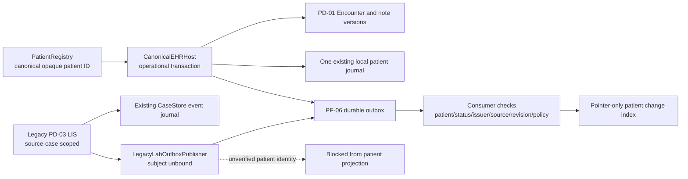

# Open Intelligence — first-party identity, EHR, LIS and governed-event integration

**Status:** working source implementation on a **stacked review branch**; not approved, merged, released or clinically deployed. **Domain scope:** PD-01 EHR / PD-03 laboratory, platform foundations PF-01 identity, PF-03 canonical source, PF-04 temporal state, PF-06 events, PF-10 authority/audit. Extends the accepted OI-16 architecture; does not substitute a new platform design. No Next.js, no new third-party runtime dependencies, no real patient records.

## Integration objective and demonstrated result

This branch composes the *actual unmerged implementations* of:

| Parent PR | Component | Actual boundary |
| --- | --- | --- |
| [#51](https://github.com/OpenxIntelligence/open-intelligence/pull/51) → [#53](https://github.com/OpenxIntelligence/open-intelligence/pull/53) → [#56](https://github.com/OpenxIntelligence/open-intelligence/pull/56) | Qualified, durable legacy source binding and CaseStore LIS order/accession/QC/release | CaseStore / source versions; synthetic-only historical case |
| [#85](https://github.com/OpenxIntelligence/open-intelligence/pull/85) | `PatientRegistry` | Sole operational issuer of canonical opaque patient IDs |
| [#74](https://github.com/OpenxIntelligence/open-intelligence/pull/74) | `ClinicalEncounters` | Operational encounter and immutable authored-note versions, **not** PF-03 published facts |
| [#70](https://github.com/OpenxIntelligence/open-intelligence/pull/70) | `platform_events` | Typed outbox, leased redelivery, receipt inbox, ordered consumer, **not** authorization |

**Implemented integration**: `CanonicalEHRHost` is the first-party host for the encounter domain, using the **same `sqlite3.Connection` and transaction** as `PatientRegistry` and the typed outbox. The EHR command writes its operational state + idempotency receipt, appends metadata to the existing patient journal, and enqueues an `oi.domain-event/1` envelope. A failure in any step rolls the entire command back. `VerifiedEHRChangeConsumer` builds a patient-scoped, **pointer-only** operational change index, verifying actual source aggregate and revision, exact patient binding, event provenance, order, and a caller-supplied authorization policy. The EHR remains the only author of note text. No `cases` table is required for the canonical patient path.

**Laboratory transition bridge**: `ClinicalLabOperations` now accepts an *optional in-transaction* event hook. `LegacyLabOutboxPublisher` publishes the existing five operational LIS events to **the same envelope format**, atomically with the legacy CaseStore order/accession/QC/release transaction. **It sets `subject_binding_id: null` intentionally.** A legacy `case_id` is not a canonical `patient_id`; source-bound LIS events **must not** enter the Patient World Model until a separate verified binding and purpose/consent authorization is implemented. The ordered patient consumer rejects unbound lab events. This is real LIS-to-transport code with a deliberately incomplete patient-identity link, not a claim that lab-to-patient interoperability is production ready.

## Event, identity and authority contract

| Contract concern | Implemented behavior | Production gap |
| --- | --- | --- |
| One patient ID | `identity_patients` issues opaque canonical IDs; EHR references them, never creates a second patient record | Proven identity, reconciled identifiers, EHR clinical master identity, record merges/unmerges |
| Transactional EHR writes | Same SQLite transaction covers encounter/note, command receipt, journal and outbox | PostgreSQL equivalent, migration/backup/restore, isolated DB roles |
| Event identity/ordering | Deterministic event IDs from command and aggregate/version; strict schema, ordered revision and idempotent consumer receipt | Cryptographic issuer verification, signed policy receipt, cross-process transport authorization, multi-worker observability |
| Clinical provenance | EHR note history and source aggregate refs remain inspectable and immutable | PF-03 source version publishing, span-level provenance, explicit clinical review/attestation authority |
| Clinical authority | Host-supplied policy denies by default, current patient must be active; no HTTP route | Verified IdP, purpose-based consent, relationship permissions, emergency access, signed decision receipts |
| LIS identity | Events include typed origin and legacy-source reference but have **no patient binding** | Only an authorized, reviewed, reversible PF-01 relationship may link a case/source to a canonical person |
| Medical actions | Note attestation is a recorded domain event, not a legal signature; LIS result release remains the fictional source-linked contract | Laboratory regulatory workflow, signer certificate, verified clinician roles, QMS, CLIA/lab partnerships |
| Patient privacy | No note bodies or specimen narratives in event envelopes or patient change index | PHI-safe encrypted persistence, retention/deletion, audit, incident response, independent security assessment |

## Implementation paths

- `src/open_intelligence/patient_registry.py` — reuses [#85](https://github.com/OpenxIntelligence/open-intelligence/pull/85) exact source.
- `src/open_intelligence/clinical_encounters.py` — reuses [#74](https://github.com/OpenxIntelligence/open-intelligence/pull/74) with one reviewable additional `request_key` reference in the four existing internal event calls, supplying genuine command correlation.
- `src/open_intelligence/platform_events.py` — reuses [#70](https://github.com/OpenxIntelligence/open-intelligence/pull/70) exact source.
- `src/open_intelligence/clinical_lab.py` — reuses [#56](https://github.com/OpenxIntelligence/open-intelligence/pull/56) with an optional `event_hook` called *inside* the existing transactional command; unconfigured behavior is unchanged.
- `src/open_intelligence/platform_integration.py` — *new* canonical host, event publisher, verified change consumer, legacy lab event transport.
- `tests/test_platform_clinical_integration.py` and `tests/test_platform_lab_outbox_integration.py` — *new* end-to-end, adversarial, crash-recovery and identity separation regression cases.
- Unmodified original domain and transport tests are included to protect upstream semantics.

## Verified before pushing to GitHub

The combined worktree was built from actual GitHub Actions **source-under-test** archives for PR #56 (stacked #51/#53), #85, #74, #70. Git blob checks matched the current branch's versions of `store.py`, `patient_access.py`, `clinical_lab.py`, `patient_registry.py`, `clinical_encounters.py`, and `platform_events.py` before adapting the two clinical modules. GitHub Actions pull-request artifacts represent an observed **merge checkout** whose `commit.txt` differs from the PR branch head; the content/blob correspondence was therefore checked explicitly, rather than assuming artifacts were HEAD builds.

- **Local combined unit+HTTP suite:** `PYTHONPATH=src:. python -m unittest discover -s tests -p 'test_*.py' -q` → **326 tests passed** (includes all inherited domain tests and 11 new integration tests: 8 EHR/PF-01/PF-06, 3 LIS/outbox). This was executed locally; it is not a hosted CI claim.
- Python `compileall` and JavaScript `node --check` passed on the combined worktree.
- End-to-end tests demonstrate: canonical patient without `cases` table; scheduled → in-progress → completed encounters; note draft → attestation → corrected draft → re-attestation; EHR state + command + journal + outbox rollback; leased delivery + idempotent consumer; duplicate replay; out-of-order rejection; independent DB reopen; wrong-patient and forged-reference rejection; suspension / missing authority; source-anchored LIS order → specimen → QC → result-release events with **unbound** patient identity; LIS rollback on event failure.
- **Required next check:** hosted CI for the *exact integration PR head*, not any individually passing parent PR, followed by a real independent code/security review.

## Explicit unresolved production gates and follow-on engineering

1. **Link the LIS source contract to the canonical patient registry without coercing a case ID into a person ID.** Preserve organization, system, source subject, proof of matching, human decision, reversibility, time, and policy/consent state; add mismatch/revocation/relink tests. Do not guess binding from text or match by display name.
2. **Promote authored clinical note versions through the authoritative PF-03 SourceVersion API** with span anchors and provenance—not by copying narrative into a second EHR or creating an AI-confirmed fact. Define correction-to-staleness semantics and signed author identity.
3. **Ship a PostgreSQL-backed transactional equivalent**, schema migrations and explicit domain permissions. SQLite shared connection is an engineering proving ground and does not establish distributed atomicity or multi-site isolation.
4. **Record verifiable PEP/consent decisions** independent of model outputs and client claims. No real patient data, live clinical orders or medical decisions until the security, institutional, clinical and regulatory gates are independently passed.
5. **Improve event distribution** with message broker integration, retries, issuer authentication and consumer isolation. `subject_binding_id` and `authorization_decision_ref` are *claims inside event bytes*, never independent evidence of access authority.
6. **Reconcile and merge intentionally:** review stacked #51 → #53 → #56, then inspect source overlap with #85/#74/#70 and this branch; run actual-head combined CI after each integration. No automatic branch merges, silent replacement of AGENTS/architecture decisions or scope reduction.

**Product direction**: The implementation advances the first-party healthcare platform. Synthetic data are test fixtures, not a substitute for operational clinical workflows or a limit on the product roadmap.
