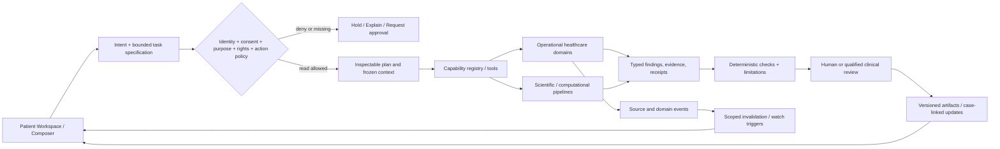

# Open Intelligence — Patient Workspace & Composer/Copilot Contract
Status: **Proposed complementary product/UX capability** · 2026-11-02 · founder clarification. **Not** an implemented tool, approved clinical product, revised L1–L7 architecture, or authorization to expand the Nov 4 synthetic demo. Read with canonical Notion Product Vision, 19-Intelligence-Architecture, OI-04 UX/IA, 33-UI-Design-Spec, 30-Patient-Experience-Design, GitHub source and existing governance.

## Product thesis
Open Intelligence is one first-party healthcare operating environment with a continuously maintained, evidence-backed representation of each patient's past and current medical and biological history; operational domain products and built-in scientific/clinical/research tools; governed automation; and a contextual **Composer/Copilot** through which an authorized person can ask questions, plan work, initiate qualified computations and investigations, inspect evidence, and track all results to resolution.

The Composer is **not** an EHR chat widget, general open-web advice bot, or a substitute for direct clinical views. It is an intention-to-work interface over the existing patient/source/clinical-event/evidence/investigation/authority contracts. It must never create a second patient model, invent records, infer permissions from text, or elevate a research hypothesis to a clinical decision. This adds interaction and execution contracts to, rather than supersedes, the established architecture.

## 1. Whole-patient information available to the platform
Organize **past, current, pending, corrected and superseded** records. Persist original artifacts with ownership and immutable versions; normalized domain objects and patient-world projections are derived from source evidence, not substitutes for operational systems.

| Family | Representative source/operational objects | Links preserved |
| --- | --- | --- |
| Identity, context and authority | Patient/case, identifiers, caregivers, care team, relationships, consent/grants and revocation | Organization, person, purpose, permission and scope |
| Medical history | Diagnoses, problems, prior care, procedures, admissions, family/social history, allergies, chronic conditions | Encounter, provider, timeframe, version, source |
| Oncology | Disease episodes, stage, lesions, symptoms, response assessment, course, recurrence and survivorship | Diagnosis/episode, treatment, modality, time |
| Laboratory | Orders, specimen accession, QC, individual and serial results, ranges, units, corrections | Patient/specimen/test/method/observed time; order != performed |
| Imaging | Studies, series, images, reports, measurements, comparison scans, acquisition date | DICOM identities, lesion, reader, version; report != pixel analysis |
| Pathology | Slides, tissue blocks, specimen lineage, diagnosis reports, immunohistochemistry, amendments | Chain of custody, sampling location, collection date, assay |
| Genomics/omics | Variant calls, RNA/protein/immune results, processing and quality, reference population | Assay, specimen, pipeline/model version and interpretive limits |
| Therapy and medicines | Medication history, regimen, planned/order/dispensed/administered doses, radiation, surgery, toxicity | Intent vs actual exposure, interval, reasons stopped, organ function |
| Patient experience and care | Goals, values, function, symptoms, quality-of-life reports, appointments, care tasks and access barriers | Author, proxy, date, decision owner, acknowledgement vs completion |
| Scientific intelligence | Versioned articles, guidelines where licensed, trials, target/drug records, research datasets, model output | Rights, publication/retrieval date, disease applicability, uncertainty |
| Computation and operations | Analysis jobs, model checkpoints, research notebooks/results, sample requests, follow-up and reviews | Input fingerprints, policy, environment, tool receipts, decision/action/outcome |

Every fact specifies **what** was observed, **whose**, **which specimen/lesion/episode**, **when occurred**, **when known**, **source and exact anchor**, **method and units**, **certainty/quality**, **permission**, **supersession/review status**. Missing, unreported, not-tested, pending, failed-QC, negative and contradictory are not interchangeable. Comparisons are valid only after compatibility checks.

## 2. Composer's jobs
The interface must distinguish five command classes without making the user learn pipeline commands:

1. **Ask** — grounded question over already authorized records: "What did the latest pathology report say about margins?" Results: answer, source/line/version, uncertainty and disclosure limits. No tool execution falsely implied.
2. **Explore** — dynamically inspect case relationships and chronology: "Show the lab trend alongside treatment exposure and imaging dates." Results: query definition, normalized units, chart/table, source anchors and missing data.
3. **Investigate** — scoped question, evidence retrieval and counterevidence appraisal: "What is known about this reported molecular finding in this disease context?" Results: plan, sources/version/cutoff, applicability, unresolved questions and candidate hypothesis; no eligibility/treatment claim.
4. **Analyze** — run authorized specialized computational pipelines on eligible data: e.g. quantitative trend analysis, variant annotation or properly qualified omics/image processing when actual input assets and tools exist. Results: immutable inputs, executed/not-executed receipts, reproducible artifacts and scientific limitations. A report PDF is not automatically raw image analysis.
5. **Monitor & prepare** — request a governed watch, compare new reports to reviewed state, flag changes, prepare review packets or queue care-team work; triggers yield reviewable tasks, not inferred clinical authorizations.

Different command classes have different UI labels, validation and permissions. An open natural-language input may help construct these **typed** tasks for authorized professional users, but cannot execute tools or return unsupervised medical advice simply because its text resembles a command.

## 3. User-facing workspace design (desktop-first)
Preserve the accepted UX research constraints (one question per screen; Glance -> Inspect -> Verify; source one click away; current changes visible; role-specific trees). Do not freeze final menu order before user research/card sorting.

- **Persistent patient header:** verified fictional/test or real authorized audience, active patient/case identity, organizational context, as-of / source cutoff, available records, unresolved missingness, active permission scope. Prevent wrong-patient carryover.
- **Central clinical workspace:** context-sensitive Overview, longitudinal Timeline, Records/Source Verification, Labs, Imaging/Pathology, Molecular, Treatments, Investigations, Evidence, Care and Review. Actual visible modules depend on role, authorization and data; not empty placeholder menu items.
- **Contextual Composer:** compact, keyboard accessible input at side/bottom; expands to a **Work Session** displaying task definition, selected case/time range, attached evidence and tools, budget, run history and artifacts. It follows selection (e.g., lab chart, lesion, exact paragraph) only with explicit context chips.
- **Right-side Inspect/Verify drawer:** claim/source anchor, prior versions and alternative interpretations, provenance, limits, method, data compatibility and audit. Opening a cited result never loses the active work session.
- **Runs / Review Inbox:** durable queue of active, blocked, completed, failed, cancelled, stale and review-needed work with actual receipts. Avoid the illusion that a chat response is a completed experiment.
- **Role-specific surfaces:** professional users may inspect research hypotheses and analysis plans; patient/caregiver views show their own source documents and governed released/approved interpretations via the separately accepted patient design. **No unrestricted generative medical advice to patients.** Source access must not be broadly delayed just because an OI-generated explanation awaits review.
- **Responsive and accessible:** target office desktop/laptop, accessible keyboard/screen-reader focus, clear long-running task status and restrained disclosure. Mobile-first workflow is not selected.

### Example progressive interaction
User, scoped to fictional CASE-ALPHA: "Compare the latest CBC with prior values and treatment dates, then flag what needs review."
1. Composer displays **case / source cutoff / available labs / relevant treatments / selected intent / no external egress**.
2. System classifies a read-only data join plus deterministic unit/range checks and a review-preparation proposal; asks to resolve date/unit/identity ambiguities, instead of silently coercing.
3. Preview: sources and versions, calculation steps, outputs (trend chart, exception table, citation list), cost and permission tier; confirm if any non-read effect or external computation requires it.
4. Run is queued, executes only allowed tools, records actual computation attempts/results, handles timeout/cancellation and persists independently from UI.
5. Results show **Observed data** (source-backed) vs **Computed finding** (method with caveat) vs **Hypothesis** (awaiting qualified review) vs **Review/task proposal** (not an order).
6. A reviewer may accept, reject or request more evidence within their legally supported scope. A new corrected CBC invalidates only dependent outputs, not the original facts, and can trigger a controlled re-run request.

## 4. Full lifecycle, not chat transcript

The system can plan/execute in parallel only when identity, grants, source cutoffs, data dependencies and resource budgets permit. Authoritative clinical events must come from qualified operational domain commands, **not** direct chat messages or research model outputs. The Patient World Model is a longitudinal projection of those events and sources.

## 5. Proposed typed contracts (adapt to existing code; do not invent a second ledger)
### ContextEnvelope
`actor_id, organization_id, role, patient_or_case_id, case_context_version, purpose, grant_refs, consent_version, requested_action_class, as_known_at, data_cutoff, selected_source_refs, locale`.

### ComposerIntent
`intent_id, input_text, classifier_version, command_class, structured_goal, ambiguities, expected_artifact_types, suggested_capabilities, constraints, status`. Text is untrusted; identifiers and permissions come from host state, not prompt extraction.

### WorkPlan
`run_id, question_id?, context_hash, inputs[source_ref + version + anchor + rights], permitted_tools[version + args_schema + access_class], task_dag, outputs, validation_checks, external_egress_manifest, budget, risk_class, approvals_required, expiry`.

### RunEvent
`run_id, task_id, state, timestamp, command_hash, tool_identity, execution_receipt, input/output fingerprints, error/hold reason, review_context`. State machine extends existing investigation and job contracts, not a conflicting second workflow.

### ResultArtifact
`artifact_id, case_scope, claim_kind (observation/computation/hypothesis/review/action/outcome), evidence_refs, methods_versions, data_cutoff, uncertainty, source_compatibility, verification_receipts, review_state, staleness_status, derived_from, allowed_audience`.

Contract requirements: idempotency, retries, explicit tool-denial, redaction, revocation, lineage, model/pipeline identity, current-vs-as-known-at query, scoped regeneration and cancellation semantics. Results are source-backed; patient-space persistence and research history are distinct. **A conversation is not the source of medical truth.**

## 6. Tool and automation registry
Register capabilities by declared **inputs, purpose, preconditions, side-effect class, outputs, validation, version, permitted scopes, resource cost and rights** rather than free-form model-selected code. Example capability categories:
- Data: source import with original preservation, OCR/extraction as proposal, FHIR/HL7/DICOM adapters, source identity/QC, terminology mapping, timeline assembly.
- Analytics: unit-aware trends, relevant treatment-context overlay, diagnostic imaging measurement only when actual image data/approved pipeline exist, genomics/omics QA, comparisons against lawful controls.
- Intelligence: literature metadata + lawful full-text access where cleared, evidence appraisal, disease context retrieval, clinical-trial criterion assessment as *screening hypotheses*, knowledge/provenance checks.
- Workflow: create scoped review task, schedule authorized recomputation on changed source, prepare source-linked case brief, request data, coordinate receipt, maintain options and prerequisites.
- Safety: deterministic high-priority symptom/lab screening as a **future separately qualified clinical function**, with staffed escalation and explicit verification; no autonomous treatment or pretending someone was notified.

Automations use domain events and explicit authorization. Each watcher specifies triggering event, affected-case filter, snapshot and source cutoff, cost/concurrency limits, idempotency, expiry, escalation owner and emitted artifacts. Example: corrected pathology -> invalidate affected comparison/hypothesis -> create review task -> optionally queue a bounded re-analysis. An external phone call, order, provider message, study enrollment or specimen shipment requires a separate approved effect and real receipt.

## 7. Action/risk matrix
| Work | Current synthetic engineering interpretation | Intended eventual governance |
| --- | --- | --- |
| Retrieve existing source, chronology, already reviewed claims | Deterministic read-only local operation | Authorized actor, subject and purpose |
| Compile a lab chart with real numerical checks | Only if source values, units and dates are valid | Audit + data compatibility and scope |
| Retrieve scientific material | Offline synthetic fixtures or approved limited public metadata | Source license, network egress and rights receipts |
| Run omics/image pipelines | Only existing validated research probes against permitted data; never claim clinical usefulness | Bounded tool approval, compute budget, reproducible pipeline and independent evaluation |
| Generate new interpretation | Source-grounded draft/hypothesis, no automatic clinical promotion | Professional review and function-specific regulation |
| Persist a clinical order / release, patient alert, treatment decision | **Out of scope of unqualified demo** | Verified identity, clinician authority, operational workflows, patient consent and receipts |
| Trigger automatic monitoring | Synthetic source-change work queue | Permissioned watch, renewal/expiry, rate limits, qualified review |

The founder's red architectural/clinical policy changes require human review as described in PRODUCT_CONSTITUTION draft PR #55. Engineering-agent governance and **in-product medical/research agents** are two different systems with independent authority checks.

## 8. Acceptance scenarios (synthetic-only for now)
A. Complete fictional longitudinal case with at least prior diagnoses, serial labs, report-only imaging, pathology versions, treatment history, separate specimens, goals, notes and unresolved questions; missing data declared and not invented.
B. Composer question over exact source -> inspect -> verify original anchor/version; wrong-patient switch clears scope and does not leak answers/history.
C. Lab/treatment time-series with unit/date/QC mismatch -> explicit hold instead of fabricated trend.
D. New pathology amendment -> only dependent Composer result becomes stale; existing event and original remain.
E. Scientific investigation -> show plan, permitted evidence cutoff, source rights, counterevidence, hypothesis and abstention; no fabricated citation or eligibility.
F. Computation request with only a report and no raw image/omics files -> `not_executed: missing_input`; no fake model result.
G. Durable run survives browser restart, can be cancelled, and stores exact partial/failure receipt.
H. Revoked grant / rights HOLD / egress not allowed -> tool denied and case metadata protected, including in logs, exports and attached artifacts.
I. Patient view: only released/plain-language approved interpretations, no clinician-internal research hypotheses; original source visible as allowed.
J. A watcher on a corrected synthetic lab creates one idempotent review work item, not a second lab result or silent medical action.

## 9. Presentation priorities
- **High value, low noise**: only clinically/currently consequential deltas, provenance and next necessary action prominent; deep graphs and raw sources on demand.
- **Trust over animation**: precise status words (asked / planned / authorized / running / actually executed / result ready / reviewed / action performed).
- **Human steerability**: pause/cancel approved research work; change scope and replan with a new version rather than silently modifying an active run.
- **Every work session leaves a durable artifact**, even if result is abstention, error, cancellation or unanswered question.

## 10. Delivery boundary and dependencies
This spec defines an intended full-platform experience. **Nov 4 demonstration restrictions remain in force** (the existing task-template research/investigation interfaces, synthetic records and no general free-text clinical chat/patient-facing screens). A later bounded Composer slice should be a *typed task launcher* connected to existing questions, synthetic source state and investigation status; it should not claim natural-language, imaging, comprehensive EHR, clinical recommendation, multi-agent execution or production authorization until those paths exist and pass task-specific validation.

No specific frontend framework, message bus, database, model/provider, cloud or final navigation tree is selected by this proposal. The founder's **no Next.js** and commercially independent core technology decisions apply. Evaluate future implementation through existing OI-00/04/08/10/12/19 docs and reviewed ADRs.

## Existing source crosswalk
- Accepted complete first-party product direction: Notion 01-Product-Vision-and-Scope (founder decision 2026-11-02).
- Shared L1–L7, operational domains and model/job runtime: Notion 19-Intelligence-Architecture.
- Clinical investigations, specialist models and consent: Notion 08-Agents, Investigation Lifecycle & Human Authority.
- Visual/role-specific UX: Notion OI-04 Information Architecture, UX and Design System; 33-UI-Design-Spec; 30-Patient-Experience-Design.
- Existing prototype: root README_IMPLEMENTATION.md, src/open_intelligence, web/ and tests/.
- Existing engineering governance: docs/engineering/REPOSITORY_AUDIT_2026-11-02.md and Product Constitution **draft PR #55**, not adopted on main.

This document is a source-linked **design extension**, not an architecture replacement, production claim, or authorization to deviate from active tasks and merge approvals.
