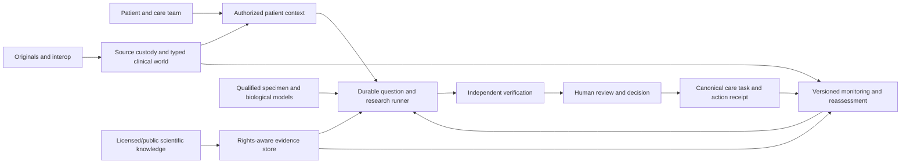

# Open Intelligence — 70-Area Capability-to-Technology Crosswalk

**Engineering requirements map · 4 November 2026 · Proposed contracts, not an implementation or clinical-readiness certificate.**

**Source of requirements:** founder-provided 70-area Master Product, Platform & Scientific Intelligence Blueprint. **Implementation evidence anchor:** [current merged main at a5a5482f815c](https://github.com/OpenxIntelligence/open-intelligence/commit/a5a5482f815ceb3c322cdfb32ab8b18c1c0e8709), [existing 50-row vision-to-reality audit PR #459](https://github.com/OpenxIntelligence/open-intelligence/pull/459), and [current H1 reconciliation draft PR #463](https://github.com/OpenxIntelligence/open-intelligence/pull/463). Scope is only the artifacts inspected on 4 November 2026; concurrent branch work must be rechecked at exact heads.

**Decision precedence:** [founder and architecture precedence](https://app.notion.com/p/40a3866f77ef8154bf15c7bb53138c9f); [adopted product blueprint](https://app.notion.com/p/40a3866f77ef81199312f0887a7d8f3b); [existing execution backlog](https://github.com/OpenxIntelligence/open-intelligence/blob/main/docs/EXECUTION_BACKLOG.csv); [research-only enterprise architecture OI-18](https://app.notion.com/p/19f3866f77ef824eb164015c9c8d735c).

## 1. What this mapping changes — and does not

The blueprint is **one governed connected platform**, not 70 microservices and not a new canonical registry. Each capability below names its owning *bounded context*, information contract, proposed output, dependencies, implementation wave and minimum acceptance proof. These are target requirements until a separately versioned implementation receipt proves a narrower behavior. Do **not** promote a checkbox from this table. Match live code/CI evidence to PR #459's 50-row matrix and the canonical backlog; an unknown is **unverified**, not "absent."

The bounded H1 stack is **Python 3.12 / FastAPI / Pydantic 2 / SQLAlchemy 2 / Alembic / PostgreSQL 16** with **React / Vite / TypeScript**. **No Next.js** in new first-party H1 work. Keep the current Python/SQLite/browser-JavaScript reference behavior available during convergence. H1 retrieval is **structured, terminology and lexical only**; vector search, graph databases, Kubernetes, parallel agent swarms, and specialist molecular pipelines are contingent technology choices, not presumed H1 dependencies. The target first-party healthcare ecosystem still includes EHR, LIS/LIMS, PACS, genomics, pharmacy, care operations and science.

**Actual current-state boundaries:** current merged H1 #390 established synthetic-only source/evidence/question/follow-through continuity. The 50-row PR #459 enumerates scoped observed main behavior. PR #463 is a distinct draft convergence candidate; its presence does not prove integration into main. Neither branch establishes live provider interfaces, licensed guideline ingestion, a general medical OCR parser, autonomous treatment, clinical validation, real-PHI readiness or deployment authorization.

## 2. Operating architecture: first-party ownership, replaceable infrastructure

| Logical owner | Authoritative data / action | Proposed ports and outputs | Implementation policy |
| --- | --- | --- | --- |
| Identity, policy & consent | Patient/actor/organization identifiers, links, delegations, consent, purpose and revocation | Scoped actor context, grant receipt, identity quarantine, access decisions | Deny by default; never merge patient identities by model inference |
| Originals, ingestion & interop | Original bytes, file/media hashes, source family/version, acquisition attempts, transcription claims | IntakeAttempt, SourceVersion, parsed candidate, provenance map, FHIR/HL7/DICOM adapters | No parser/connector may silently create accepted clinical facts |
| Clinical/oncology World Model | Typed assertions, time, episode, medication, specimen, diagnosis, uncertainty, conflicting states | PatientSnapshot, FactProposal, amendment event, expected-data gap | Existing source/record owner; preserve missing/negative/pending/indeterminate distinctions |
| Evidence, terminology & rights | Claim→source edges, metadata, use rights, study design, retractions and evidence quality | RightsDecision, EvidenceRecord, ClaimSupport, SourceSpan, Applicability | Per-artifact/usage rights; external scientific content separate from patient records |
| Specimen, omics & biological graph | Assembly/transcript/sample context, genes, variants, mechanisms and biological relationships | Versioned variant, assay QC, typed biological edge, compute receipt | Graph is an owned semantic model; Postgres edges first, graph DB only if benchmarked |
| Question, research & agent runtime | Saved questions, source/evidence snapshot, plans, tool calls, checkpoint and reports | InvestigationRun, CandidateFinding, VerificationReceipt, ModelReceipt | Host-owned typed tools; bounded autonomous loops only after maturity gates |
| Decision, review & care tasks | Alternatives, reviewer decisions, rationale, task state, approvals, action receipts | ReviewDecision, OptionDossier, CareTask, ReassessmentRequest | AI output is never reviewer approval; one canonical owner for task/decision |
| Experience | Patient/clinician/research views over same authorized data | Overview, Evidence & Questions, Research, Review, Action, original-source drill-down | Low-noise, progressive disclosure, accessible and context-preserving |
| Research compute & controlled enclave | Approved data projections, versioned pipelines, experiment and model artifacts | AnalysisRun, Hypothesis, ExperimentReceipt, reproducible reports | Isolation and consent-aware secondary use; no direct patient-store reads from arbitrary jobs |
| Security, privacy, quality & enterprise | Policy and clinical-risk controls, audits, model/supply chain inventory, incident/release decisions | PolicyDecision, SafetyHold, AuditEvent, QualificationRecord | Function-specific intended-use and rights gate before wider activation |

**Deployable topology:** begin with domain-enforced modules and transactional PostgreSQL plus encrypted object storage when required; put content indexing, evidence views and graph relations behind rights-aware projections. The event/outbox spine carries versioned changes into the review, research and notification systems. Extract a separate service only for measured fault isolation, PHI/tenant boundary, workload profile, licensing boundary or independent deployment need. No "one database per feature" assumption.

## 3. Canonical data, state and authority contracts

```text
Acquisition request + purpose + patient/actor binding
  → IntakeAttempt (connector/upload/manual; source terms, outcome, reason)
  → OriginalArtifact (exact bytes/media, hash, storage, custody)
  → SourceVersion (family, event/effective/received times, source metadata)
  → CandidateAssertion (typed value + units + specimen/assay + exact span)
  → Qualified human/coded admission to Patient World Model
  → Immutable snapshot + missingness/conflict/uncertainty + source lineage
  → Patient-scoped Question / Investigation with frozen source/evidence rights
  → Scientific Evidence / Counterevidence / Applicability / Candidate hypotheses
  → Independent verifier + accountable human ReviewDecision
  → Patient-appropriate explanation + OptionDossier + owned CareTask
  → Follow-through receipt / amended source / new publication / revoked access
  → Dependency-scoped freshness reassessment (history retained)
```

Each clinical/source/evidence reference needs a stable ID, tenant/patient scope, author/origin, assertion type, effective and recorded time, source version/hash/precise location, terminology+units+specimen where relevant, rights/purpose, epistemic state, and dependent outputs. A calculated value, a sourced observation, an extracted proposal, a reviewer interpretation and a research hypothesis must have different object types. Evidence edges are *assertions with support*, not proof of biological causality.

Write paths are deterministic. The API checks authorization when preparing a request, at the point of transaction, and when preparing outbound content; revocation must withhold future bytes and links. Tool executions have versioned inputs, budget, expiry, retry/idempotency key, outputs and durable receipts. A model has no direct canonical-table or approval write.

**Proposed event classes (not claims of implemented endpoints):** `source.version.received`, `identity.binding.proposed`, `assertion.reviewed`, `source.amended`, `evidence.version.changed`, `investigation.output.stale`, `review.returned`, `care_task.changed`, `authorization.revoked`. Include source aggregate/version, cause, replay key, actor/purpose and affected dependency identifiers. Consumers must tolerate duplicates and out-of-order delivery without erasing history.

**Data planes:** (1) identifiable care records and originals with strict purpose enforcement; (2) licensed scientific/public knowledge with a separate rights ledger; (3) separately authorized, de-identified/controlled research projections; (4) metrics and AI evaluation without default PHI logs. No cross-plane materialization without an explicit lawful/technical decision.

## 4. Capability map: each numbered area has an owner, information contract and test

**Phase key:** P0 = integrated synthetic patient/source/intelligence foundation; P1 = permitted scientific evidence and governed investigation; P2 = molecular and trial research; P3 = deeper clinical/omics/institutional platform; P4 = reproducible discovery and collaboration; P5 = long-horizon simulated or autonomous scientific research. These are dependency waves, **not dates or release claims**. P0-parallel regulatory/privacy review is mandatory before real-data work. Suggested owners are module responsibility names, not newly appointed employees.

| # | Capability area | Logical owner | Inputs → produced result | Dependencies | Wave | Minimum exit evidence |
| --- | --- | --- | --- | --- | --- | --- |
| 01 | Patient identity, workspace & account management | IDENTITY | Patient demographics, account assertions, provider links, delegated grants, consent → Versioned identity/grant receipts, authorized role-scoped workspace | Patient linkage + auth/consent policy | P0 | Wrong-person isolation; delegation expiry and revocation |
| 02 | Unified healthcare data platform | CLINICAL | Source versions, encounters, structured and unstructured observations → Temporal typed assertions, longitudinal patient projection and conflicts | Canonical source custody + clinical vocabulary | P0 | Original preserved; conflicting and missing facts visible |
| 03 | Universal ingestion & interoperability | SOURCE | Manual input, scans, PDFs, HL7, FHIR, DICOM, devices, partner APIs → Source receipts, quarantine reasons, extracted candidates, transform lineage | Identity, rights, adapters, original storage | P0→P2 | No silent patient merge; replay/idempotency; malformed-source quarantine |
| 04 | Complete oncology information model | CLINICAL | Cancer diagnosis, stage, pathology, specimens, treatments, responses → Versioned oncology episode and evidence-qualified disease context | Clinical assertions, oncology terminology and professional review | P1 | Multiple primaries/assays/line histories not conflated |
| 05 | Patient education & scientific translation | PATIENT | Reviewed record context, lawful education sources, patient preferences → Reading-level/language adapted explanations with uncertainty and source links | Rights-aware retrieval, approved clinical wording, review policy | P1 | No unreviewed therapy directive; comprehension and citation tests |
| 06 | Patient intelligence workspace | PATIENT | Current case, uncertainty, questions, tasks, reports and grants → Low-noise timeline, attention, question, source and next-step views | Patient context and action/authority projections | P0 | Same-case continuity; wrong-case clearing; accessible resume |
| 07 | Genomic intelligence | BIOLOGY | Assay/assembly/transcript/specimen-qualified variants and QC → Versioned variant interpretation candidates and evidence links | Source specimen chain, annotation and permitted datasets | P2 | No variant actionability without assay/version/evidence basis |
| 08 | Multi-omics intelligence | BIOLOGY | RNA/protein/single-cell/spatial datasets, batch/QC metadata → Harmonized analysis artifacts with uncertainty and reproducible jobs | Specimens, rights-cleared datasets, compute pipeline | P3 | Cross-assay sample linkage and held-out batch-effect checks |
| 09 | Biological ontologies & knowledge graph | BIOLOGY | Versioned public/approved entity vocabularies and claim sources → Typed evidence-linked relationships, graph queries and snapshots | Terminology, rights, source provenance | P2 | No invented causal edge; provenance and license per edge |
| 10 | Scientific literature intelligence | EVIDENCE | DOIs/PMIDs, metadata, rights-cleared abstracts/text, corrections → Versioned studies, searchable claims, confidence and retraction status | Rights broker, citation verifier, source registry | P1 | No restricted full-text leakage; retraction changes impact outputs |
| 11 | Scientific investigation engine | INVESTIGATION | Question, authorized patient snapshot, source/evidence set, tools → Durable investigation, competing hypotheses, evidence matrix and report | Evidence graph, deterministic retrieval, model evaluation, review | P1 | Abstains on missing evidence; reproducible resume and citation checks |
| 12 | Personalized research pathway | INVESTIGATION | Current cancer profile, variants, treatments, goals, rights → Patient-specific dossier with relevance, limits and update receipt | Clinical/PWM + literature + evidence applicability | P2 | Negative applicability and changed-profile re-ranking are shown |
| 13 | Clinical trial intelligence | EVIDENCE | Versioned registry entries, protocols, locations, patient criteria → Candidate trial comparisons, unknown-eligibility flags, contact prep | Legal trial feed, clinical facts, human eligibility review | P2 | Trial status/criteria recency; unknown never becomes eligible |
| 14 | Drug intelligence platform | THERAPEUTICS | Drug identifiers, labels, targets, status, licensed interaction data → Versioned drug/target evidence and safety-context research | Rights-cleared drug knowledge and clinical records | P2 | Drug ID/route/dose/status retained; no autonomous treatment order |
| 15 | Therapeutic target discovery | THERAPEUTICS | Disease biology, perturbation, human genetics, replication studies → Target hypothesis portfolio with tractability and contradiction | Biological graph, research datasets, validation criteria | P4 | Independent validation and falsification before promotion |
| 16 | Computational drug discovery | THERAPEUTICS | Structures, compound datasets, target context, simulation configs → Versioned screening/simulation results and candidate artifacts | Isolated compute, licensed tooling, assay feasibility | P4 | Reproduce run; flag model uncertainty, rights and untested chemistry |
| 17 | Translational research & experimental validation | RESEARCH | Protocols, specimen metadata, experimental results and negative results → Experiment/validation receipts and preclinical→clinical evidence mapping | Research workspace, provenance and ethical/quality controls | P4 | Trace specimen/protocol/QC; negative results preserved |
| 18 | AI core, models & retrieval | INVESTIGATION | Versioned model/tool config, authorized context and source snapshots → Bounded candidate findings, citations, eval/cost/latency receipts | Policy, model gateway, eval corpus and verified retrieval | P1 | Task-level held-out eval; no vendor lock-in or silent fallback |
| 19 | AI agent orchestration | INVESTIGATION | Typed task DAG, grants, budget, checkpoint, available skills/tools → Paused/resumed runs, tool audit, validated candidates, failure receipts | Existing investigation owner + governance; not a second ledger | P3 | Cancellation, child quiescence, retry identity and cost gates |
| 20 | Scientific evidence, reasoning & trust | EVIDENCE | Exact spans, rights, study design, conflicts, versions, interpretation → Claim-evidence-counterevidence links and reviewable uncertainty | Source custody, provenance and citation verification | P0 | Wrong passage, superseded source and absent citation fail closed |
| 21 | Clinical knowledge intelligence | EVIDENCE | Guidelines by lawful entitlement, FDA/EMA labels, versioned standards → Guideline references and rights-qualified clinical knowledge context | Rights broker, terminology and clinical review | P1 | NCCN H1 metadata/link only; no unlicensed content use |
| 22 | Clinical decision support | CLINICAL | Verified clinical states, risks, alternatives and source-backed guidelines → Clinician-facing comparisons and scoped pending review, never silent orders | Intended-use gate, qualified review, safety/clinical evaluation | P3 | Regulatory/function assessment precedes patient-impacting release |
| 23 | Personalized clinical intelligence | CLINICAL | Patient trajectory, biomarker evidence and relevant reviewed science → Patient/clinician-specific evidence report and discussion opportunities | Patient context + research + review authority | P2 | Evidence applicability and clinician approval separately visible |
| 24 | Biological visualization | PATIENT | Versions of genes, pathways, networks, single-cell/spatial outputs → Interactive science diagrams with provenance overlays | Biology graph, permission-aware visualization | P3 | Clickable original claims; redaction and large-graph usability |
| 25 | Patient data visualization | PATIENT | Source-linked time-series, episodes, medications and care events → Clinical timeline, comparisons, change markers and unknowns | PWM, chronology and authorization | P0 | No speculative trend diagnosis; accessible screen-reader labels |
| 26 | Scientific research visualization | PATIENT | Literature networks, claims, hypotheses, trial and target datasets → Evidence maps and explainable candidate landscape | Research/evidence graph and lawful content rights | P2 | Visual relationship always opens its supporting sources |
| 27 | Advanced research workbench | INVESTIGATION | Investigation artifacts, notebooks, annotations and authorizations → Branchable, exportable reviewed investigation workspace | Durable run state, research objects and group grants | P2 | Concurrent edit/conflict/restore and source-version replay |
| 28 | Computational biology environment | RESEARCH | Permitted analysis data, containers, code, resource budgets → Isolated job artifacts, logs and reproducibility receipts | Research enclave, compute policy, artifact rights | P3 | Tenant and network isolation, replay and resource exhaustion |
| 29 | Bioinformatics pipeline management | RESEARCH | FASTQ/BAM/VCF/omics reads, references and manifests → QC, alignments, calls, analysis and exact pipeline metadata | Specimen linkage, compute runner and reference versions | P3 | Deterministic manifest and no sample/assembly mismatches |
| 30 | Machine learning & scientific modeling | RESEARCH | Rights-cleared cohorts, labels, endpoints and code → Validated research models, cards, calibration and drift records | Research enclave + approval + benchmarking | P3 | External validation; cohort leakage checks and calibration |
| 31 | Patient-clinician collaboration | ACTIONS | Attributed messages, shared records/questions and reviewer scopes → Communication, review decisions and human-owned referrals | Identity, grants, task/decision owner | P1 | Time-limited access, attribution and revoked-output withholding |
| 32 | Research collaboration | RESEARCH | Team projects, publications, annotations, protocols and datasets → Permissioned investigation artifacts and shared notebooks | Research workspace + source/rights and audit | P3 | Cross-project access denial and attribution |
| 33 | Institutional platform | ENTERPRISE | Org/department hierarchy, users, contracts and policy → Tenant-bound configuration, institution operations, billing metrics | Identity, policy, domain APIs and audit | P3 | No tenant bleed across all search/export/analytics endpoints |
| 34 | Research data collaboration | RESEARCH | Consented cohorts, DUAs, de-identified datasets and requests → Approved cohort projections, federated results and disclosure receipts | Privacy governance + separate research enclave | P4 | Re-identification tests; purpose-limited and revocable access |
| 35 | Security architecture | ASSURANCE | Credential/session grants, policy, secrets, telemetry, threats → Enforced access, audit, incident and recovery evidence | Every domain; independent final-authority checks | P0 | Wrong actor/case, race-time revocation, egress and recovery |
| 36 | Privacy & data governance | ASSURANCE | PHI categories, genomic rights, consents, retention and DUAs → Purpose enforcement, privacy audit, deletion and export plans | Identity, patient/source boundaries and legal review | P0 | No PHI before approved architecture and agreements |
| 37 | AI governance | ASSURANCE | Models, prompts, tool grants, risk classes, failures and metrics → Model inventory, evaluation receipts, policy and incident routes | AI runtime, safety validators and human authority | P1 | Prompt-injection, leakage, hallucination and rollback eval |
| 38 | Regulatory & quality management | ASSURANCE | Function-specific intended uses, hazards, requirements, validation → Risk files, traceability, quality/release decisions, CAPA evidence | Clinical/legal/quality owner sign-off | P0 parallel | No clinical use without applicable product/regulatory decision |
| 39 | Backend architecture | PLATFORM | Domain commands/queries, identities, transactions, events → Stable versioned APIs and domain-owned state | Accepted H1 Python/FastAPI/PostgreSQL contracts | P0 | One canonical writer per type; migration and rollback tested |
| 40 | Database & storage infrastructure | PLATFORM | Typed clinical rows, originals, binaries, graph edges, job receipts → Transactional records, versioned objects, backups and projections | PostgreSQL 16; object adapter only after exact rights/security | P0 | Restore original/version/rights and reject cross-case recovery |
| 41 | Search infrastructure | PLATFORM | Authorized patient records, source text, metadata and vocabularies → Context-filtered lexical/structured results with exact provenance | Search projections + final authorization + evaluation | P0 | H1 no vector index; query never leaks revoked records |
| 42 | DevOps & reliability | PLATFORM | Code builds, manifests, migrations, logs and signed artifacts → CI results, monitoring, recovery, SLO and integrity evidence | Repo/CI, rights gate and operational owners | P0 | Exact-head test/migration/browser + recovery artifacts |
| 43 | Patient analytics | PATIENT | Data completeness, case flow, tasks, reported outcomes → Patient value and quality measurement, opt-in diagnostics | Patient history and analytic privacy controls | P2 | Show denominator, uncertainty and not-for-care scope |
| 44 | Scientific analytics | RESEARCH | Literature/experiment/biomarker/trial versioned activity → Research performance, gap trends and evidence dashboards | Research/evidence and rights-approved aggregation | P2 | Source-defined counting, publication freshness and reproducibility |
| 45 | Enterprise analytics | ENTERPRISE | Aggregated platform work, uptime, compute and billing events → Operational dashboards and cost/quality insights | Telemetry allow-list, tenant separation, billing owner | P3 | Privacy-safe aggregates and independently verified denominator |
| 46 | Intelligent notifications | ACTIONS | Consent/relationship, clinical and research change events → Permissioned, severity-qualified alerts with actionable receipts | Change intelligence, scheduled jobs and clinical alert policy | P1 | Revocation/quiet-hours, duplicate suppression and safe message |
| 47 | Workflow automation | ACTIONS | Source arrivals, tasks, review states, job checkpoints → Deterministic orchestration and retryable human-action receipts | Canonical task/decision owner + durable outbox | P1 | Never silently perform clinical action; exactly-once effects via IDs |
| 48 | Persistent knowledge system | EVIDENCE | Source-linked patient/research facts, corrections and decision history → Permission-aware versioned memory and retraction lineage | Patient evidence graph + provenance + retention policy | P1 | Revocation, deletion, stale-memory and wrong-case tests |
| 49 | Research continuity | INVESTIGATION | Open questions, prior investigations, snapshots and unresolved gaps → Resume, compare, supersede and recheck receipts | Durable investigation and dependency graph | P1 | Resume with frozen inputs; amendment invalidates only dependents |
| 50 | Platform administration | ENTERPRISE | Users, tenant roles, config, models, agents and audits → Least-privileged management surfaces and logs | Identity, policy and operations | P2 | Admin cannot bypass patient/purpose constraints |
| 51 | Commercial infrastructure | ENTERPRISE | Service contracts, plans, entitlements, metered usage → Invoices and chargeback without medical-content exposure | Billing adapter + privacy/rights segmentation | P4 | Billing telemetry excludes PHI and respects tenant entitlements |
| 52 | Developer platform | PLATFORM | API specs, credentials, webhooks, sandbox fixtures → Documented external integrations and scoped developer access | Versioned domain APIs + sandbox + audit | P3 | Webhook replay, scope/version failure, revocation and abuse tests |
| 53 | Precision oncology intelligence | BIOLOGY | Integrated staged oncology states, biopsy series, variant histories → Longitudinal tumor hypotheses and evidence-graded molecular views | Specimen/assay + clinical PWM + evidence | P3 | No equivalence of specimens; uncertainty calibrated |
| 54 | Systems biology | BIOLOGY | Curated regulatory networks and multi-omics perturbations → Versioned mechanistic models and testable simulations | Validated biological ontology and research compute | P4 | Falsification and cross-dataset model checks |
| 55 | Digital biology / digital twins | RESEARCH | Longitudinal data, model assumptions, calibrated parameters → Research-only virtual models with explicit uncertainty envelopes | Multiscale modeling, external validation and risk gates | P5 | Prospective validation before any predictive clinical claim |
| 56 | Autonomous research infrastructure | INVESTIGATION | Verified research tasks, tools, budget and evidence contracts → Durable agent findings with human review and reproducibility | Investigation engine + security + isolated compute | P4 | Multi-agent disagreement, interruption, rollback, cost and leakage |
| 57 | Future therapeutic discovery | THERAPEUTICS | Human/preclinical evidence, screened candidates and experiments → Falsifiable target/compound/combination research portfolio | Biology, chemistry, translational validation | P5 | No clinical actionability implied by predicted binding/synergy |
| 58 | Phase 1 foundation milestone | PROGRAM | Identity, source custody, timeline, safe intake and questions → Full synthetic patient-to-source-to-question workflow receipt | 01–03, 06, 20, 35–42, 65–70 | P0 | Exact integrated replay and failure/recovery matrix |
| 59 | Phase 2 research milestone | PROGRAM | Rights-cleared literature, evidence and investigation inputs → Cited scientific comparison and patient research dossier | 10–12, 18, 20, 48–49 | P1 | Independent citation/right/contradiction verification |
| 60 | Phase 3 genomics milestone | PROGRAM | Specimen-linked variants and biomarkers → Molecular context and cautious trial candidate map | 07, 09, 13, 23 | P2 | Assay/assembly/versioned-variant replay and qualified review |
| 61 | Phase 4 multi-omics milestone | PROGRAM | Research-approved multi-omics assays and compute → Reproducible cross-omics reports | 08, 28–30 | P3 | QC, batch-effect, provenance and reference reproducibility |
| 62 | Phase 5 clinical/therapeutic milestone | PROGRAM | Drug/target knowledge, trial criteria, guidelines → Reviewed evidence-based clinical research comparisons | 13–15, 21–23, 31 | P2→P3 | Regulatory and clinical review before patient-impacting use |
| 63 | Phase 6 enterprise scientific AI milestone | PROGRAM | Institutional tenants, isolated computation, collaboration → Auditable institutional investigation/research service | 19, 28–34, 45, 50, 52 | P3→P4 | Load/recovery/tenant privacy and model-policy gates |
| 64 | Phase 7 autonomous discovery milestone | PROGRAM | Validated research graph, molecular models and experiments → Reproducible discovery proposals and research portfolios | 15–17, 53–57 | P5 | Independent scientific replication; no autonomous treatment |
| 65 | Foundational architectural principles | GOVERNANCE | Founder decisions, accepted H1 scope and review constraints → Versioned architecture rules and conflict register | Precedence, ADR review and source inspection | P0 | No accidental adoption of proposed Next.js/vector/license changes |
| 66 | Six interconnected intelligence layers | GOVERNANCE | Patient, clinical, biological, research, therapeutic, AI contracts → One coherent domain/API/event ownership map | Shared identity, evidence, audit and source provenance | P0 | Cross-layer references never create second canonical facts |
| 67 | Bidirectional central data flow | PLATFORM | Patient/source changes, knowledge revisions and review results → Dependency-linked updates and authorized outward actions | Transactional outbox, idempotent projections, stale states | P0 | Late/out-of-order events and revoked outputs handled correctly |
| 68 | Five shared technical assets | GOVERNANCE | World model, evidence, biological graph, personalized research, execution → Owned architectural interfaces, ownership and version contracts | Patient + evidence + biology + investigation modules | P0→P2 | Trace source → assertion → evidence → review → action |
| 69 | Definition of done | ASSURANCE | Code, data/permission contracts, workflow tests, source rights → Accepted verification packet linked to exact branch, SHA and use | CI, provenance, security, human/clinical validation gates | P0 | No unverified checkmark or inherited CI claim |
| 70 | Capability maturity levels | GOVERNANCE | Requirement registry, status labels, test/PR/release references → Evidence-backed Level 0–5 state with next blocker | Existing OI backlog + PR459 evidence matrix | P0 | Separate implemented, integrated, deployed and clinically validated |

## 5. How to convert a mapped area into a buildable specification

For each capability create a scoped record **inside the existing backlog/requirement owners** with: identifier; patient/research job; authorized actors/purposes; exact source and transform contracts; persisted objects; read/write/event ports; permissions and usage rights; positive/negative/pending/conflicting outcomes; UX states; model/tool role, if any; deterministic fallback; acceptance scenario and negative tests; exact commit+CI links; rights/security/regulatory constraints; maturity/approval state. Avoid a separate roadmap database unless it mirrors canonical IDs.

**Example P0 intake capability:** an authorized fictional patient creates a record request or adds a typed/manual/PDF original; the system preserves exact bytes and origin, binds to the correct person/case, marks extraction as a *candidate* only, and lets a reviewer accept/correct a typed observation with source+specimen+time. A changed original creates a new version and flags only dependent questions, summaries, reports, reviews and tasks for reassessment. Wrong-case, duplicate, lost-response, mid-request revocation, revoked read, altered bytes, parser failure and backup/restore are required tests. This example is a specification; existing main/branch evidence must be matched separately.

## 6. Missing cross-cutting requirements to add to the full plan

1. **Acquisition workflow as a product:** consented record requests, patient-portal export, direct upload, trusted caregiver/clinician entry, OCR/transcription, institutional feeds, wearable data, rejected/partial imports, and a visible missing-record queue. Every source mode must preserve an acquisition receipt and answer who supplied it.
2. **Patient/master-identity and source-resolution lifecycle:** tentative matches, merge/unmerge, organizations, encounters, specimens, lab/report versions, author identity, timestamps and wrong-patient quarantine.
3. **Care coordination as the intelligence-to-action bridge:** human owner, referral, appointments, specimen/retesting request, insurance/financial navigation, pending response, completion evidence and reopen rules.
4. **Decision and uncertainty graph:** alternatives, rationale, dissent, missing evidence, contraindications, guideline divergence, applicable vs inapplicable research and independent review authority.
5. **Specimen and assay ledger:** collection site/date, tumor vs normal, aliquot, tumor purity, library prep, reference assembly, transcript/version, platform, QC and immutable lab provenance.
6. **Clinical claims and scientific claims are different products:** patient/clinician notices and hypotheses must respect intended use, clinical accuracy/impact and study applicability; preclinical findings must never be displayed as validated treatment.
7. **Knowledge rights and licensing:** code, dependency/image, scientific paper, guideline/terminology, model weights, genomic dataset and service/API rights get separate per-use records and hold decisions.
8. **Reassessment and state recovery:** source or evidence change, rights change, revised model, declined recommendation, failed job and offboarding trigger dependency-aware re-evaluation, not silent overwrite.
9. **Adversarial and human-factors evaluation:** misleading sources, hallucinated citations, wrong chronology, prompt injection, site/assay mismatch, automation bias, accessibility, comprehension and clinician review burden.
10. **Trustworthy operations:** environment boundaries, SBOM, locked artifacts, disaster recovery, retention/deletion, tenant isolation, patient data egress, audit, incident response and provenance-preserving exports.

## 7. First complete vertical slice and acceptance packet

**Work on the active H1 convergence owner (#463), not a new patient source or UI system.** Establish a single integrated, independently fictional case with patient profile and permissions; structured clinical history; records from multiple departments; a source-linked lab/pathology record and correction; a durable authored question; original-source drill-down; only permitted study metadata/evidence; a bounded candidate explanation that can abstain; explicit independent review and assigned human follow-through; then amendment, access revocation, retry and restore.

**Ship gate:** a replayable commit-specific packet proves identity/source binding, original+version persistence, no silent clinician approval, claim citation fidelity, cross-case isolation, false/unknown/conflicting states, case-switch UX, source and rights revocation, dependency-scoped stale outputs, persistent task/decision history, and full data/migration/browser/recovery verification. Software acceptance still does not equal PHI, regulatory or clinical approval.

**Next waves:** P1 lawful literature/clinical evidence ingestion + appraisal; P2 specimen-grade variants and trial candidate screening; P3 complex lab/imaging/omics and institutional workflows; P4–5 only after validated science and permissioned research operations.

## 8. Evidence, maturity and source-of-truth rules

Use the existing eight-state implementation vocabulary in [PRODUCT_REQUIREMENTS.md](https://github.com/OpenxIntelligence/open-intelligence/blob/main/docs/project-state/PRODUCT_REQUIREMENTS.md), together with user-facing maturity Levels 0–5. **Do not map Level 3/4/5 from a green PR alone.** Record branch, SHA, deployed scope, integration matrix, source rights, test logs, independent review and clinical/regulatory validation distinctly.

The existing [50-row audit in PR #459](https://github.com/OpenxIntelligence/open-intelligence/pull/459) remains the **observed evidence layer**. This document is its **70-area target/contract layer**, not a superseding implementation-state matrix. Keep the canonical [OI-001..OI-021 execution backlog](https://github.com/OpenxIntelligence/open-intelligence/blob/main/docs/EXECUTION_BACKLOG.csv) as the source of work IDs; use the `backlog_refs` column in the companion CSV as suggested associations and confirm them before assigning work.

**Verification needed before subsequent status promotion:** live main and moving PR heads, actual CI run conclusions, full H1 merge/migration history, negative authorization and output leak tests, later source/knowledge rights, and any additional clinical/evaluation protocol. No changes to code, credentials, sensitive data, dependencies, clinical intended use, release authorization or licensing are made by this crosswalk.

## 9. Storage, API, model/agent and integration overlay

The **same 70 rows** in the [machine-readable crosswalk CSV](CAPABILITY_ARCHITECTURE_CROSSWALK_2026-11-04.csv) have four additional fields: `data_store_or_plane`, `proposed_api_or_event_port`, `model_agent_or_deterministic_role`, and `candidate_external_integrations_rights_gated`. These are **design interfaces**, not claims that named routes, datasets, packages or providers have been installed. The exact API URI, schema, deployment topology and artifact rights need per-workstream acceptance.

| Domain owner | Initial storage/canonical boundary | Proposed typed port | Eligible computation/integration direction |
| --- | --- | --- | --- |
| IDENTITY | PostgreSQL patient/actor/relationship/consent and audit | `IdentityGrantPort` | Deterministic identity/permission; OIDC, SMART scope adapters later |
| SOURCE | PostgreSQL intake/versions/receipts + access-controlled original-object storage | `SourceIntakePort` | Manual upload and qualified FHIR/HL7/DICOM/portal adapters; OCR candidate only |
| CLINICAL | PostgreSQL typed and temporal Patient World Model | `PatientWorldModelPort` | Clinical-domain rules; FHIR/oncology terminology as projections |
| EVIDENCE | PostgreSQL source/claims/rights/applied-evidence edges; lexical index | `EvidenceSearchPort` | Crossref/PubMed/Europe PMC/ClinicalTrials and licensed guidelines by source/usage entitlement |
| BIOLOGY | PostgreSQL specimen/assay/variant and typed biological edges; research objects | `BiologyAssayPort` | VEP, ClinVar, CIViC, Reactome, omics pipelines only when validated |
| INVESTIGATION | PostgreSQL questions, frozen runs, checkpoints, source-linked reports | `InvestigationRunPort` | Replaceable models, deterministic tools, verifier; agent delegation maturity-gated |
| THERAPEUTICS | Versioned compound/target/experiment research data, never clinical orders | `TherapeuticResearchPort` | ChEMBL/PubChem/PDB/RDKit/MD only with exact-artifact research and rights gates |
| ACTIONS | PostgreSQL canonical review/decision/task and durable receipts | `ReviewAndTaskPort` | No automated clinician approval; scheduling/messaging adapters qualified separately |
| PATIENT | Read-only authorized projections over shared canonical data | `PatientContextPort` | React/Vite/TypeScript; explanation model gated by provenance/evaluation |
| RESEARCH | Separate permissioned analysis objects/jobs, approved projections | `ResearchComputePort` | Jupyter/R/Nextflow/ML under enclave and reproducibility gates |
| ASSURANCE | Policy/audit/QMS/risk receipts across domains | `PolicyAndSafetyPort` | Final-action authority, redaction, KMS/SIEM and function-specific review |
| PLATFORM | PostgreSQL 16 + outbox/FTS; qualified object storage, no automatic new stores | `PlatformDataPort` | Accepted FastAPI/SQLAlchemy/Alembic + CI/restore; no mandatory H1 vector search |
| ENTERPRISE | First-party org/tenant/entitlement/usage records | `TenantManagementPort` | Enterprise SSO, billing and analytics only after privacy/tenant requirements |
| PROGRAM / GOVERNANCE | GitHub canonical backlog/ADR/evidence, Notion/Drive supporting docs | `MilestoneReceiptPort` / `ArchitectureDecisionPort` | No clinical authority or automated maturity promotion |

### Existing code anchor versus proposed port

Current merged source examples include `apps/api/src/oi_api/{patients,access,sources,source_world_model,question_evidence,question_followthrough}.py` and the source-linked reference implementation under `src/open_intelligence`. These files are **evidence to inspect**, not authorization to import an entirely new implementation. `*Port` names above are **proposed interface labels only**; do not misrepresent them as live URLs or create duplicate tables/owners around them. Reuse existing interfaces when the scope already exists.

### Architecture route for an authorized research question



**Non-negotiable separation:** passing a scientific model or PubMed metadata retrieval through a port never creates an accepted patient observation, eligible trial, authorized clinical order, validated target or product release. Every transition is a policy-checked, attributable and reversible event or an explicitly reviewed clinical/scientific decision.
