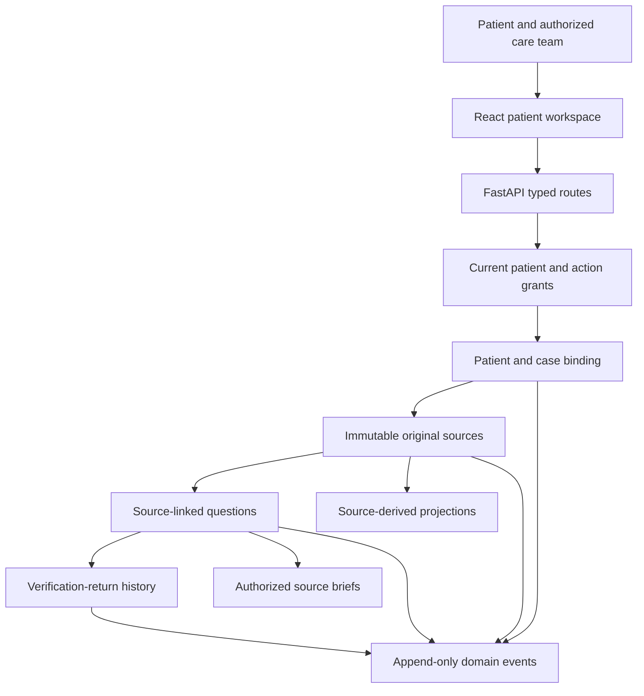

# Open Intelligence — system architecture assessment

As of 3 November 2026; observed baseline [#276, c154bfbc](https://github.com/OpenxIntelligence/open-intelligence/tree/c154bfbc5f99f76801d37903959943659c0b6a71). Accepted direction: [H1 decision register](https://docs.google.com/document/d/1YrORrdNxzT6MN-WuKVdk2vWVtVXVw9OSo0z5ARvMypg/edit).

## Existing architecture and intended progression

The implemented H1 application is a modular FastAPI composition root with PostgreSQL persistence and a React/Vite/TypeScript client. It reuses first-party domain contracts from the Python/SQLite reference. It is not a new EHR proxy and is not a set of independently deployed microservices. The current and historical architectures coexist during a migration; they must not both become writers for one production clinical fact.

Stage one adds authorized external adapters around the canonical patient/source/authority contracts. Stage two extends those same first-party domain owners to encounters, documentation, orders/results, medication workflows, scheduling, communications, care plans and administration. These future domains are not implemented merely because they appear in the architecture.

This diagram describes the H1 baseline. Source inspection from #280 is the next consumer to converge. Production identity, consent, external EHR integration and biomedical synthesis are not implied by the grant or projection boxes.

## Authoritative state and boundaries

| Domain | Existing owner | State and invariants |
| --- | --- | --- |
| Patient identity | `src/open_intelligence/postgres_registry.py`; `identity.identity_patients` | Canonical patient ID, originating organization, active/suspended status, idempotent creation. Clinical or legal identity is not established by an ID. |
| Events and receipts | `identity.identity_domain_events`, registry creation receipts | Append-only events in the same transaction as accepted domain operations. A preparation receipt is not network delivery or clinical signoff. |
| Case/subject binding | `apps/api/src/oi_api/case_bindings.py`; `coordination.patient_case_bindings` | Qualified organization/system/subject reference; immutable subject attachment, explicit revocation; no silent reassignment. |
| Record coordination | `record_requests.py`; `coordination.record_requests` | Requested/cancelled lifecycle; received state derives from an immutable source-receipt event. An operational request does not contact a provider. |
| Originals and assertions | `sources.py`; `clinical_source.source_versions`, `assertions`, `quarantine` | Exact original bytes/hash, source ID/version/line, qualified patient binding, amendment history, invalid-import quarantine. Assertions are source-reported, not medical truth. |
| World Model and preflight | `source_world_model.py`, `composer_preflight.py` | Read-only derived views over current validated originals; stable canonical snapshot fingerprint excludes per-read receipt identity. No parallel clinical store. |
| Questions | `source_questions.py`; `investigation.source_questions` | Immutable question intent and original source anchor; idempotent save; legacy/current snapshot contracts remain explicit. Amendment requires reassessment. |
| Verification returns | `question_review_returns.py`; `investigation.question_review_receipts` | Derived queue, immutable nonterminal returned receipt, exact intent retry, independent read/return grants. No clinical approval. |
| Briefs | `source_brief.py` plus existing question/source owners | Deterministic source-only text, explicit body digest and source fingerprint, new authorization for preparation/download; no new report table. |
| Authentication | `access.py` | Default deny; opt-in operator-controlled synthetic credential fixture, exact patient/action/org scope, expiration and final refresh. This is not production identity or consent. |

Sources: [API README](../../apps/api/README.md), [source/receipt contract](../engineering/H1_CANONICAL_RECORD_SOURCE_RECEIPT.md), [question contract](../engineering/H1_CANONICAL_SOURCE_QUESTION_INTAKE.md), [review contract](../engineering/H1_SOURCE_QUESTION_REVIEW_RETURN.md), [brief contract](../engineering/H1_SOURCE_LINKED_BRIEF.md).

## Transaction and disclosure contract

The source owner locks the canonical patient and case binding, revalidates the original source set, builds the requested projection, refreshes authority and appends its audit receipt before commit. Source writes, amendments and case revocation use the same ownership. Actual serialization must occur before the final authority check when a route claims that preparation is governed by that transaction. Validating only a DTO can still leave JSON rendering after the audit/commit boundary. The #280 packet route has precisely this unresolved integration boundary; the planned change follows the existing brief `JSONResponse` pattern.

This boundary does not claim distributed atomic revocation or recall of already downloaded bytes. An external grant can change after the final check. Source hashes establish equality and change detection, not authenticity, signatures or medical accuracy.

## Schema evolution

The selected baseline's single required Alembic head is `0008_review_convergence`. It explicitly joins `0007_question_snapshot_contract` and `0007_question_review_returns`. The question workflow convergence adds no table and needs no new migration. Published migrations, constraints and source-question identity formats remain unchanged.

The separate [#278 image/question/review integration](https://github.com/OpenxIntelligence/open-intelligence/pull/278) uses `0009_image_review_merge`; that is another draft owner, not this branch's schema. A future integration must preserve both published histories and prove populated upgrades. Renaming revisions or copying stores would discard lineage.

## Interfaces, storage and operations

- REST routes and generated OpenAPI are implemented. GraphQL and WebSockets are candidates without a demonstrated need for this slice.
- PostgreSQL is the H1 transactional database. SQLite is the existing behavioral reference. No cache, search cluster, workflow engine, message broker or object-store service is added by this convergence.
- Existing Docker/Compose configurations and hosted PostgreSQL 16 gates exercise synthetic startup, migration, HTTP, revocation, restart and backup/restore. They are development acceptance, not qualified production deployment.
- Clinical source input is a bounded original text format in this H1 branch. PDF annotation provenance and governed scientific reports exist in separate reference owners; DICOM original custody exists in separate H1 owners. Their presence elsewhere is not this branch's upload support.
- The React client keeps session credentials and prepared patient views in memory. Patient/case/credential changes invalidate scoped views. Client rendering is a projection, never an authority for a write.

## Design choices retained

Preserve modular ownership, one canonical patient/source history, explicit immutable provenance, independent grants and typed failure states. Reuse the existing CSS/component conventions rather than add unrelated design-system packages. Preserve the full future standalone scope while making source acquisition, understanding, questions and coordination useful incrementally. See [architecture decisions](ARCHITECTURE_DECISIONS.md) for conflicts, candidate screening and remaining gates.
