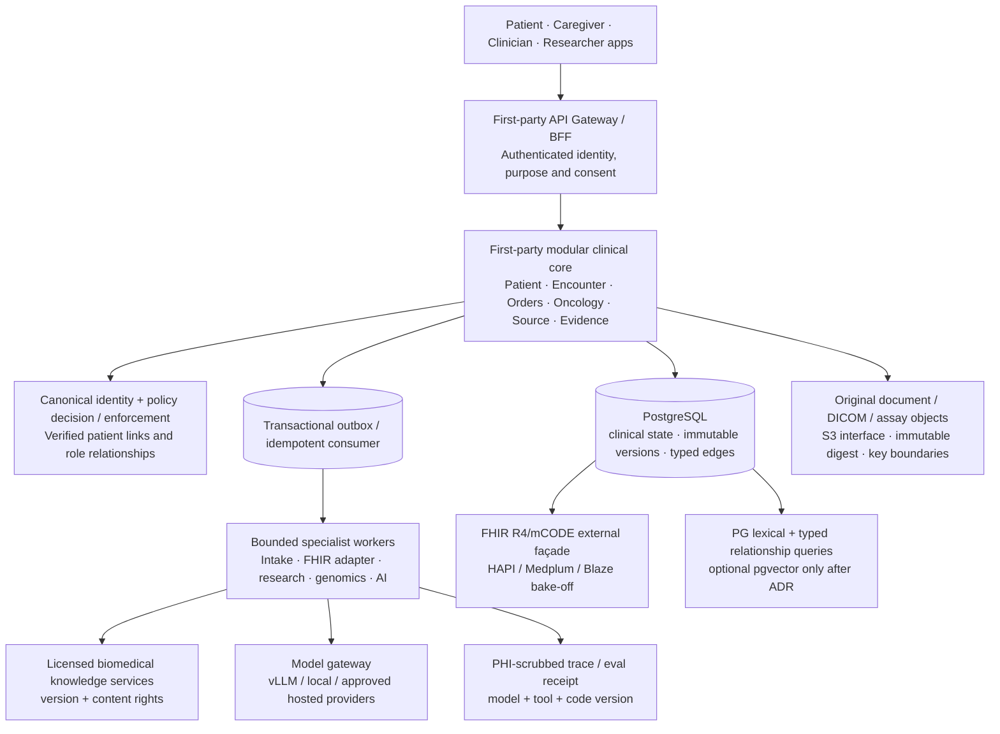

# Open Intelligence — Backend Technology Atlas, Licensing & Architecture Decision Wave

**Research snapshot:** November 2, 2026 · **Disposition:** For consideration / no license clearance or backend ADR adopted · **Owner decision:** Founder + engineering + security + legal.  
**Scope:** Commercially independent, first-party AI-native oncology and healthcare platform; full product domains PD-01–PD-16 and foundations PF-01–PF-10.  
**Canonical inputs:** OI-16 mandate, adopted OI-17, OI-18 proposal, OI-19 red team, OI-12 older research and existing *OI Master Technology Catalog* (556 candidates; source registered in Google Drive). This is a **priority and decision overlay**, not a replacement/competing catalogue or a rewrite of the running Python/SQLite software.

> **Founder objective used throughout:** Own the patient and biomedical intelligence, medical domain logic, provenance, clinical control and product experience. Use sustainable upstream permissive technology for generic capabilities; keep replaceable interfaces so models, databases, modalities and provider endpoints may evolve without replacing the canonical patient or clinical history. No Next.js. No Sid-specific medical/genomic data, named-person patient fixtures or real clinical operations.

## 1. Executive decision

**Provisional preferred core:** first-party **Python 3 + FastAPI + PostgreSQL** with explicit typed domain APIs and dedicated application modules. PostgreSQL is the operational system of record for normalized patient/event/provenance data; original source bytes live in an independent object-store interface. The first operational deployment can be a strict modular monolith with separate specialist workers, not a speculative mesh of dozens of services. The current SQLite implementations are *valuable behavior and regression specifications*, not proposed production persistence, patient identity proof or clinical clearance.

**Why this leads today:** respects already tested Python event/provenance/EHR/LIS code; Python spans biomedical data, inference and model orchestration; strong PostgreSQL consistency, SQL temporal queries and transactional outbox; versioned FHIR façade instead of a second authoritative patient database; lower operator and licensing complexity. **Selection remains subject to twelve empirical and rights bake-offs.** The weighted rubric later in this report is an *author judgment*, NOT performance or clinical benchmark data.

**Do not confuse roles:** an EHR workflow module != a FHIR server != an imaging archive != a terminology license != a model runtime != a patient-authorized clinical system. One component's permissive code license never grants commercial access to NCCN/CAP/SNOMED content, private patient information, model weights or an entire hosted AI provider.

### 1.1 Verified coverage of existing research (not a new discovery tally)

| Existing evidence class | Catalog rows | Interpretation |
|---|---:|---|
| Verified permissive | 160 | Existing source checks of some upstream code; not exact deliverable/SBOM approval |
| Unverified | 138 | No sufficient current upstream license evidence |
| Incomplete | 134 | Some evidence, missing important dependency, release, model, extension or legal data |
| Requires legal interpretation | 78 | Conditional licensing or unresolved commercial/redistribution interpretation |
| Incompatible | 46 | Not suitable under adopted OI-17 core procurement policy |
| **Total** | **556** | Existing canonical technology atlas; preserve its IDs and lineage |

Our **backend priority screen has 163 entries** (150 existing canonical IDs and 13 candidates absent from the 556-row base). Their proposed research dispositions are Evaluate now **30**, Explore alternative **39**, Defer until need **69**, Hold—rights/fit **25**. These are NOT adopted dependencies or 163 new technologies. A subset has new official-project or current license/terms evidence, the rest are explicitly flagged *CATALOG_ONLY* and require source audit.

## 2. The backend architecture we are actually choosing

**Logical/physical split:** all sixteen OI-16 clinical/administrative products are first-party logical domains with one explicit owner per record class. Start physical implementation with a few deployables; isolate GPU serving, untrusted file parsing, DICOM, genomics batch, external-provider egress where failure/PHI/licensing boundary requires it. Split an additional domain into a service only after a measurable load, isolation, regulation, location or team-release trigger. Platform boundaries are versioned contracts, not cross-domain SQL table edits.

**Irreversible choices to avoid:** FHIR data server becoming the patient-world-model master; an AI vector index substituting factual evidence; external agent frameworks holding PHI and approval state; proprietary patient identity maintained separately in every service; an event bus pretending to provide atomic cross-database transactions; reliance on a single model provider; unlicensed guideline/terminology content stored as unrestricted vector embeddings.

## 3. Competing backend language architectures

The scores below are deliberately *subjective comparative scores* (1–5, higher better). No throughput, latency, feature coverage or operational cost bake-off has yet run. Criteria weights: functional fit 25%; AI/data ecosystem 15%; existing code reuse 15%; operational simplicity 15%; future scale/portability 10%; healthcare/FHIR ecosystem 10%; model/vendor independence 10%. Changing those weights may change rankings.

| Candidate | Weighted score / 5 (judgment) | Strength | Trade-off / possible fit | Recommended status |
|---|---:|---|---|---|
| Python FastAPI + PostgreSQL | **4.60** | Direct reuse of existing first-party clinical source code; mature bio/ML | Async and CPython throughput require bounded workers and performance discipline | **Preferred bake-off baseline** |
| TypeScript NestJS + PostgreSQL | **3.96** | Strong web API contracts and FHIR SDKs; unified UI/backend types | Would port substantial Python clinical and AI source logic; two runtimes likely anyway | **Serious alternate** |
| Go API core + PostgreSQL | **3.65** | Concurrency, low overhead, single binaries; suitable egress/data gateways | Additional bioinformatics and research interoperability glue | **Best for isolated high-throughput services** |
| Rust Axum + PostgreSQL | **3.29** | Performance, memory-safety, portable systems extensions | Talent/toolchain complexity and clinical domain developer throughput | **Evaluate for parsing/compute hot paths** |
| Java Quarkus + PostgreSQL | **3.79** | Mature healthcare tooling and JVM FHIR libraries | More runtime/toolchains, rewrite costs; HAPI may suffice as service | **Great FHIR/validation edge, not general core by default** |
| Polyglot microservices from day 1 | **3.69** | Independent teams/services and specialized runtime freedom | Highest distributed-consistency burden, DevOps costs, licensing surface | **Avoid until workloads justify** |

**Decision sensitivity / counterevidence:** the small difference between Python and alternatives is affected heavily by existing code reuse. If the backend team is overwhelmingly TypeScript or operational leadership requires a JVM runtime, re-score. A Go/Rust worker for secure untrusted parsing is a complement, not a reason to port every domain. Python's native event-loop is not a GPU or DICOM image-processing substrate; use bounded processes or vectorized native libraries with separate isolation and benchmarking.

## 4. Shortlist by backend function and 2026 adoption posture

| Capability | Preferred route *for evaluation* | Serious competing alternatives | Why / condition to adopt |
|---|---|---|---|
| Domain backend API | **FastAPI (MIT), Python, Pydantic, SQLAlchemy/Alembic** | NestJS (MIT), Django (BSD), Litestar (MIT), Go Gin (MIT), Rust Axum (MIT), Quarkus (Apache) | Preserve first-party typed domain contracts and existing evidence/clinical logic; replay on PostgreSQL; benchmark validation and reliability |
| Primary relational/clinical state | **PostgreSQL (PostgreSQL License)** | SQLite for offline/test; distributed Postgres variants only if measured | ACID immutable source/version records, transaction-level outbox, patient/tenant isolation; test RLS/backup/PITR |
| FHIR server and validation | **HAPI FHIR (Apache 2.0) vs Medplum (Apache 2.0) vs Blaze (Apache 2.0)** | Microsoft FHIR Server (MIT), Firely SDK (BSD, .NET), fhir.resources (BSD) | One FHIR façade/sidecar only; do not replace OI patient/world model; conformance and loss reports decide |
| AuthN / clinical delegation / authorization | **Keycloak (Apache 2.0)** + **OpenFGA or SpiceDB (Apache 2.0)**; policy Cedar/OPA trial | Ory OSS (Apache, enterprise OEL features separately), custom PEP with policy library | Proofed patient identity, proxy/clinician relationship, purpose/consent, revocation; separate login from clinical authorization |
| Transactional domain events | **PostgreSQL transactional outbox + idempotent inbox** | NATS JetStream (Apache); Debezium (Apache); Kafka (Apache); Temporal (MIT) when durable human approvals require it | Start simple. Enqueue in same transaction as domain change; user/policy and exact-source checks always at consumption |
| Long-running clinical/research jobs | First-party durable step journal / **Temporal (MIT)** bake-off | Dagster/Airflow for data pipelines; Prefect; DBOS | Adopt only when retries and human-in-the-loop workflows outgrow existing tested journal, not by agent hype |
| Original source/large multimodal objects | **S3-compatible interface**, SeaweedFS (Apache 2.0) for independent hosting bake-off | Cloud vendor object store via negotiated agreement; first-party immutable blob store | Need immutable hash, version, encryption, retention/legal hold, recovery; **not MinIO AGPL** as a new core default |
| Patient exact search | **PostgreSQL typed queries, full text, fact/source IDs** | OpenSearch (Apache 2.0), Solr (Apache 2.0), Meilisearch CE MIT only | Exact clinical facts and source anchors first; add external index only for measured retrieval/volume limitations |
| Vector and graph | No vector authority; **PostgreSQL typed edges**; optional pgvector/AGE and Qdrant (Apache) | Jena (Apache), JanusGraph (Apache), OpenSearch vector | For **licensed public biomedical discovery**, vector may suggest candidate IDs; authoritative claims must always dereference source/version and pass verifier |
| Clinical document ingestion | **Docling (MIT code), Tesseract (Apache), Presidio (MIT)** plus bespoke source-anchor review | GROBID (Apache) for scientific papers, medspaCy, PaddleOCR | Code rights separate from OCR/ML model weights; preserve source bytes, exact page/bbox offsets, failures and human correction |
| DICOM images / viewers | **pydicom (MIT) + highdicom**; OHIF/Cornerstone (MIT); first-party permissioned DICOMweb gateway | DCMTK (BSD with notices), specialized external isolated PACS | pydicom optional GPL pixel codecs must be excluded; Orthanc GPL/AGPL needs legal exception; no AI diagnostic functionality implicitly approved |
| Pathology / multimodal | **TIAToolbox (BSD code) and MONAI (Apache code)** evaluated as research workers | OpenSlide LGPL (T2), QuPath GPL, model-specific proprietary tools | Clinical diagnosis, image weights and training data separately regulated/licensed; archive original WSI source and patches |
| Genomics | **Nextflow (Apache) with pinned rights-cleared pipelines** | Snakemake (MIT); GATK 4 Apache; htslib/samtools mixed license checks | A pipeline engine is not a verified clinical assay; reference genome, containers, algorithms and resources each need provenance |
| Model serving / inference | **vLLM Apache code; llama.cpp MIT local** behind one host-owned gateway | ONNX Runtime MIT, hosted provider under data handling agreement, MLflow for registry | No single model/provider owns approval state; datasets/weights/GPU drivers/telemetry require separate rights and risk gates |
| Agent orchestration and RAG | First-party orchestration over typed approved tools; evaluate LangGraph (MIT), Haystack (Apache), LiteLLM MIT-only core | LlamaIndex, DSPy, PydanticAI, MCP SDK | Do not adopt framework that expands tool permission or stores sensitive context by default. Multi-agent only if measured benefit |
| Ops / security / supply chain | OTel (Apache) with explicit PHI redaction, Syft/Trivy/Grype checks, reproducible containers | Prometheus, CloudNativePG, Pulumi and K8s when necessary | Reproducible build SBOM, NOTICE/attribution, version locks, audit, attack-surface and restore drills before production |

### 4.1 FHIR adversarial decision (do not pick HAPI just for popularity)

1. **HAPI FHIR:** strongest off-the-shelf Java API, conformance and validator ecosystem; adds JVM and FHIR persistence complexity. Apache-2.0 upstream. If used as its own data store, demonstrate explicit patient/source/written facts and lossless reconciliation to OI's canonical record; otherwise treat as façade/service only. [Official repository](https://github.com/hapifhir/hapi-fhir).
2. **Medplum:** TypeScript/React stack, FHIR server/SDK and medical UI examples; Apache-2.0 code. Can accelerate adapters and UI, but **do not let its FHIR rows displace PF-04/05** or accept proprietary/hosted feature assumptions. [Official repository](https://github.com/medplum/medplum).
3. **Blaze:** stable German medical-informatics FHIR R4/CQL server, Apache-2.0 per official README; particularly interesting for population research/measurement. Validate API coverage, deployment/ops cost, export and CQL license. [Official repository](https://github.com/samply/blaze).
4. **Microsoft FHIR Server:** MIT code; compare maintenance status, cloud dependencies and storage layout; not automatically better than the current FHIR candidates. [Repository](https://github.com/microsoft/fhir-server).

**FHIR bake-off output must include an *actual machine-readable round-trip field-loss manifest*** on OI's Patient, Encounter, source-linked DiagnosticReport, Observation, Specimen, Consent, Provenance and original note source histories. External FHIR standard terminology licenses and extensions must be reviewed separately. HAPI/Medplum/Blaze are presently **candidates**, not a chosen authoritative EHR.

### 4.2 Future-proof AI design: more than swapping a model name

**Model gateway contract:** input class (PHI / de-identified / public research); purpose + auth decision; allowlisted endpoint and region; model and weight/license/version; prompt, tool and preprocessing versions; schema-constrained request; quotas; explicit fallbacks; egress/log scrub; response receipt; safe re-run; auditable denial. Self-hosted model services receive scoped slices, not raw unrelated patient records. Provider plugins are optional, replaceable and non-authoritative.

**Modality registry:** each modality worker declares supported file formats (DICOM/WSI/PDF/VCF/FASTQ), compute resource class, exact input/source refs, preprocessing, evidence category, output authority and failure mode. Biological inference, model prediction and clinician-reviewed opinion are separate epistemic kinds. Specialized models run in sandboxed jobs; no agent is granted direct record write, messaging, clinical order, prescription or access-grant authority.

**Continual learning:** immutable data/model version ledger and instrumented evaluation with independent reviewers. New evidence or an amended source marks dependent derived claims stale through durable event/dependency semantics; recompute with source-level proofs. Do *not* train on personal medical histories without separate rights and authorization. An AI architecture is future-proof if model family can change **without losing patient/source history**, not because it has the largest agent framework.

**Do not assume vectors are essential on day one.** Structured terminology, full text, source IDs, deterministic safety logic and reviewer-controlled hypotheses are first-class. A vector index of licensed public literature may be evaluated for *discovery* after an approved ADR; it never becomes the source of truth or a workaround for guideline copyright.

## 5. License and source-risk decisions that materially change the backend

The following is the release-risk screen to reconcile with the adopted OI-17 register. Commercial business use is not the same as permissive licensing, and a T1 source code license is not a security/clinical release ticket.

| Risk | Source or candidate | Current block / boundary | Required next action |
|---|---|---|---|
| LR-01 | [MinIO](https://github.com/minio/minio) | AGPL-3.0 archived upstream in April 2026; original project no longer maintained | Use Apache-2.0 SeaweedFS candidate or S3-compatible provider; execute retention+durability/availability bake-off |
| LR-02 | [Redis 8](https://redis.io/legal/licenses/) | RSALv2 or SSPLv1 or AGPLv3; no currently permissive server license | Use Valkey BSD-3; do not infer server license from client licenses |
| LR-03 | [Meilisearch](https://github.com/meilisearch/meilisearch/blob/main/LICENSE) | Root file MIT AND BUSL; enterprise directory is not MIT | Explicitly exclude EE and scan release artifact; consider Postgres FTS first |
| LR-04 | [Neo4j Community](https://github.com/neo4j/neo4j) | GPL-3.0; enterprise licensing distinct | Use SQL typed edges initially; if needed evaluate Apache AGE/Jena |
| LR-05 | [Memgraph](https://github.com/memgraph/memgraph/blob/master/LICENSE) | BUSL 1.1 plus enterprise terms | Do not embed or deploy as free-core assumption |
| LR-06 | [Orthanc](https://github.com/orthanc-mirrors/orthanc) | Core GPLv3+; DICOMweb and database plugins AGPLv3+ | Evaluate first-party DICOMweb/pydicom or isolated unmodified service only after legal approval |
| LR-07 | [Medplum](https://github.com/medplum/medplum) | Apache-2.0 core; packaged apps, plugins and hosted/commercial scope differ | Use as FHIR edge/SDK bake-off, not canonical OI record; pin subpackages and inspect all assets |
| LR-08 | [Ory Kratos](https://www.ory.com/kratos) | Apache-2.0 OSS but SAML/SCIM/organizations and some security release support OEL | Validate core meets multi-tenant PHI/clinical federation needs before committing |
| LR-09 | [Infisical](https://github.com/Infisical/infisical) | MIT outside ee/; enterprise assets require other terms | Compare operational OSS against Keycloak/service KMS and secrets management |
| LR-10 | [HashiCorp Vault](https://github.com/hashicorp/vault) | BUSL-1.1 code is not Tier 1 | Cloud KMS or future permitted secret storage alternatives; OpenBao MPL T2 only |
| LR-11 | [Docling](https://github.com/docling-project/docling) | MIT code; PDF processing model weights may have separate terms | Pin exact models + OCR assets, disable auto downloads pending rights review |
| LR-12 | [TIAToolbox](https://github.com/TissueImageAnalytics/tiatoolbox/blob/develop/LICENSE) | BSD-3-Clause code, separate pretrained model licenses | No clinical image inference; evaluate weights/data for each model |
| LR-13 | [pydicom](https://github.com/pydicom/pydicom/blob/main/pyproject.toml) | MIT and GDCM-derived BSD notices; optional GPL-licensed jpeg plugin extra | Package minimal code/extras; disallow GPL pixeldata extra by default |
| LR-14 | [vLLM](https://github.com/vllm-project/vllm/blob/main/LICENSE) | Apache-2.0 code but model weights, containers, CUDA/NVIDIA and dependencies separate | Maintain model/weight rights registry and build-scoped SBOM |
| LR-15 | [GATK 4](https://github.com/broadinstitute/gatk/blob/master/LICENSE.TXT) | Current GitHub LICENSE.TXT Apache 2.0; 2024 Broad help and 2026 site still say BSD-3 | Pin release/tag LICENSE.TXT, bundle/patent notices; report docs inconsistency without inventing relicensing date |
| LR-16 | [SeaweedFS](https://github.com/seaweedfs/seaweedfs) | Apache-2.0 core; enterprise edition contains operational features | Prove S3 access, object encryption, legal hold, backup/restore and security before production |
| LR-17 | [Patient data and terminology](https://www.hl7.org/fhir/license.html) | FHIR code licenses do not clear SNOMED, NCCN, CAP protocols, patient data, trial/content rights | Separate terminology/content/PHI authorization records from code SBOM |
| LR-18 | [AI and biomedical models](https://github.com/vllm-project/vllm) | Model code does not clear weights, reference data, annotations or intended clinical uses | Immutable provenance & usage rights for every weight/dataset/evaluation before any model download |
| LR-19 | [AGPL/BUSL/MIT mixed releases](https://github.com/meilisearch/meilisearch/blob/main/LICENSE) | Repo LICENSE may not represent per-directory EE or plugin terms | Lock to artifact digest with dependency SBOM, SPDX for every included component, separate optional extras |
| LR-20 | [Standalone OSS services](https://www.hhs.gov/hipaa/for-professionals/security/index.html) | Permissive license is not medical readiness, secure configuration, contractual BAA or HIPAA coverage | Validate deployment architecture, roles, de-identification, threat model, key management and clinical intended use |

**Examples of version-specific licensing traps:** [Redis 8 is AGPLv3 / SSPLv1 / RSALv2, not BSD](https://redis.io/legal/licenses/) (although Redis <=7.2 was BSD-3), versus [Valkey BSD-3](https://github.com/valkey-io/valkey); [Meilisearch Community MIT](https://github.com/meilisearch/meilisearch) while its Enterprise Edition is BUSL/commercial (root repo `MIT AND BUSL-1.1`); [archived MinIO GNU AGPLv3](https://github.com/minio/minio) versus [SeaweedFS Apache-2.0](https://github.com/seaweedfs/seaweedfs). Data, model weights and enterprise edition terms are *outside* generic repo license assertions. A single permissive code license cannot establish “zero legal risks.”

**Release evidence required per exact artifact:** source tag/commit + SHA; official license file; dependencies including optional extras/containers; SPDX SBOM; copyright/patent attribution; assets/docs; model weight + training source rights; data/terminology rights; commercial modifications/forks/distribution; security advisories and SBOM scanning; legal hold and approved intended use; owner/legal review. **Unknown = fail closed**. Strong copyleft/source-available services may be researched for interoperability but are not silently embedded as first-party core.

## 6. Twelve executable technology bake-offs before signing a stack ADR

These are **tests to run, not tests claimed to have been run**. Each experiment should record exact immutable source SHA, reproducible command, dependency lock/SBOM, environment, performance, privacy and negative/rollback results. A human owner sets concrete targets *before* testing and rejects options that violate safety or OI-17 even if fast.

| ID | Decision gate | Preferred first benchmark | Realistic alternative | Minimal pass requirement |
|---|---|---|---|---|
| B-01 | Core language/transaction spine | Python FastAPI + PostgreSQL | NestJS + PostgreSQL; Go/Rust edge | No lost updates; complete history; ID confusion 0; performance recorded |
| B-02 | FHIR façade | HAPI FHIR JPA; Medplum; Blaze | Microsoft FHIR Server; Firely SDK reference | No fabricated fields; lost fields listed; patient authorization enforced |
| B-03 | Identity and purpose | Keycloak + one of OpenFGA or SpiceDB + Cedar/OPA choice | Ory OSS only | Fail-closed; revocation propagation + full audit; no cross-tenant leak |
| B-04 | Events/durable work | Postgres transactional outbox + idempotent consumer | NATS JetStream then Temporal where needed | No PHI in envelopes; no duplicate clinical state; replay bit-identical where promised |
| B-05 | Object storage | Local encrypted dev → SeaweedFS S3 bake-off | Commercial S3-compatible with BAA/contract | Object SHA and source ID preserved; loss/recovery verified |
| B-06 | Search and graph | Postgres FTS + typed edge tables | OpenSearch, Apache AGE | Exact source anchor retrieval; no patient data leakage across scopes |
| B-07 | Embeddings/vector | No embeddings for clinical facts | pgvector then Qdrant only if justified | Improves discovery vs exact/lexical; every candidate resolved by source ID |
| B-08 | Document extraction | Docling plus Tesseract; optional GROBID for literature | MedspaCy / scispaCy extraction | No lost source; pages, spans and uncertainty; reviewable errors |
| B-09 | Molecular workflows | Nextflow with pinned, rights-cleared pipelines | Snakemake | Same outputs pinned; variant origin and lab assay provenance preserved |
| B-10 | Model serving | vLLM server and llama.cpp local; stable model gateway | Hosted provider by optional DPA/BAA; ONNX Runtime | No unapproved egress; source-grounded claims only; replay/latency measured |
| B-11 | Ops and supply chain | OpenTelemetry + Syft/Trivy/Grype reviewed versions | Prometheus + CloudNativePG later | No data in observability; source artifact SBOM+NOTICE+digests |
| B-12 | Graph and research data | Typed edges and PostgreSQL materialized views | Jena/AGE, Arrow/DuckDB/Iceberg when research enclave starts | Trace links correct; no privileged record leak into research exports |

**Scorecard mechanics:** For each alternative collect raw results rather than conflating them with the current subjective 4.60/5 Python score. At minimum measure (i) source loss/mutation, (ii) mis-bound patient/case risk, (iii) permission denial/leak, (iv) query/replay determinism, (v) end-to-end p50/p95, (vi) CPU/RAM/disk and energy proxy, (vii) implementation engineer-hours, (viii) update/rollback/recovery, (ix) locked license/SBOM status and (x) operational staffing. Zero critical identity/rights/provenance failures is a **gate**, not a weighted scoring trade-off.

### 6.1 Near-term implementation sequence

- **Gate 0 (now):** Freeze the accepted OI-16 and OI-17 requirements, license approval schema, product domains and existing Python/SQLite behavioral tests. Do not rewrite working EHR, LIS, patient registry, source-version or outbox modules purely to introduce a framework. Trace current PR #95 and the overlapping PRs to one canonical patient owner, one clinical source owner and one permission boundary.
- **Gate 1 (core):** Build PostgreSQL migrations, ACL/RLS PEP, transactional outbox, source history and immutable audit replay. Run the identical 355-test synthetic integrated logic on SQLite and Postgres and compare all receipts before switching authoritative state. No PHI until authenticated identity, consent and encryption gates exist.
- **Gate 2 (interfaces):** FastAPI/OpenAPI domain facade and FHIR R4 bake-off HAPI/Medplum/Blaze; one signed record export/import with explicit data-loss report and source authority, not FHIR-based clinical auto-verdict.
- **Gate 3 (patient value):** Original document store, OCR/review, Patient World Model, rights-qualified biomedical retrieval, task/agent orchestration, saved source-linked report, and immutable human review. Make the **complete patient-information → evidence investigation → source-linked review** loop function before adding more infrastructure.
- **Gate 4 (heavy specialties):** Imaging PACS/WSI and genomic batch in isolated runners; phase in caches/search/vector/event brokers only when measured workloads and legal/clinical scope justify them.
- **Gate 5 (AI future):** Model/provider/weights registry, guarded multimodal workers, comparative agent evaluation and independent scientific collaborator validation. Model uncertainty and clinical decision authority remain separate.

**Proposed release tiers:** source available upstream ≠ package pinned ≠ dependency legally verified ≠ technically adopted ≠ test-passing integrated ≠ deployed ≠ medical/clinical validation ≠ approved real patient use. Record each state separately; none is implied by the one before it.

## 7. Integration with the current canonical program (no duplicated authoritative work)

- **Primary product and architecture:** [OI-16 accepted mandate](https://drive.google.com/file/d/1_OBrshpcETQ6lgrcts4JVaVo6kRce8Z0/view) and [OI-18 architecture proposal](https://drive.google.com/file/d/1XgNBNmaSgksQTx189ctKf6Ahv4C2coXS/view).
- **Mandatory legal and commercial rights:** [OI-17 adopted rights policy](https://drive.google.com/file/d/15jhFNNeXxpmmYKgfEK2SYXzq6GIZlJrZ/view), [Notion rights](https://app.notion.com/p/40a3866f77ef815a97d5e016ededf5b9).
- **Canonical technology records:** [556-row master catalog](https://drive.google.com/file/d/1AbApfOo44YwjjhuRHGuGYfB5Y-Rlg2CT/view), [license register](https://drive.google.com/file/d/1pvAWEciPQXD8mklvz52UbiO-oqfHxeOt/view), [decision register (TDR-001…100)](https://drive.google.com/file/d/1g1VvJSCknZk49nVl7emzrNsrww7mF_zE/view), [existing comparison](https://drive.google.com/file/d/1YJU7DcOs5oTo0Or0mDTkG5Z4qOE9Z0bk/view), [discovery backlog](https://drive.google.com/file/d/1EpnCNzJOGyZBzOAVSGPVvTR19GGz9SBJ/view).
- **Complementary active PRs:** [#127 source-linked OSS inventory](https://github.com/OpenxIntelligence/open-intelligence/pull/127), [#125 licensing discovery](https://github.com/OpenxIntelligence/open-intelligence/pull/125), [#66 supply-chain gate](https://github.com/OpenxIntelligence/open-intelligence/pull/66), [#95 integrated patient/EHR/LIS event work](https://github.com/OpenxIntelligence/open-intelligence/pull/95). These own their respective implementation/verification; this analysis makes no writes to their branches.
- **Target docs:** this dossier and the companion screen/risk/bakeoff files are **proposal overlays** with canonical IDs, not a second main registry or approved stack declaration. Fold verified new entries back into the owner-maintained catalog only after exact-source and legal review.

## 8. Selected official references and explicit verification limitations

| Source | Specific verified point |
|---|---|
| [PostgreSQL license](https://www.postgresql.org/about/licence/) | PostgreSQL permissive distribution, modification and independent hosting |
| [FastAPI pyproject](https://github.com/fastapi/fastapi/blob/master/pyproject.toml) | MIT code; optional `standard` extras contain other dependencies |
| [HAPI FHIR repository](https://github.com/hapifhir/hapi-fhir) | Apache-2.0 FHIR Java ecosystem |
| [Medplum repository](https://github.com/medplum/medplum) | Upstream Apache-2.0 core; feature/subpackage/provider boundaries separate |
| [Blaze FHIR](https://github.com/samply/blaze) | Apache-2.0 server + CQL, declared German research/biobank uptake |
| [NestJS repository](https://github.com/nestjs/nest) | MIT TypeScript backend serious alternative |
| [OpenFGA](https://github.com/openfga/openfga/blob/main/LICENSE) | Apache-2.0 relationship engine upstream code |
| [Temporal](https://github.com/temporalio/temporal) | MIT durable workflow server upstream |
| [SeaweedFS](https://github.com/seaweedfs/seaweedfs) | Apache-2.0 S3-compatible candidate |
| [Redis official licensing](https://redis.io/legal/licenses/) | Redis 8 AGPL/SSPL/RSAL; prior BSD version doesn't transfer |
| [Valkey license](https://github.com/valkey-io/valkey/blob/unstable/LICENSES/BSD-3-Clause.txt) | BSD-3-Clause alternative |
| [MinIO archive](https://github.com/minio/minio) | AGPLv3 and archived Apr 25, 2026 |
| [Meilisearch root license](https://github.com/meilisearch/meilisearch/blob/main/LICENSE) | MIT AND BUSL; CE vs EE distinction |
| [vLLM license](https://github.com/vllm-project/vllm/blob/main/LICENSE) | Apache-2.0 code; separate weight/runtime rights |
| [pydicom license/packaging](https://github.com/pydicom/pydicom) | MIT source; optional codec GPL caveat must be audited |
| [GATK current LICENSE.TXT](https://github.com/broadinstitute/gatk/blob/master/LICENSE.TXT) | Apache-2.0 current code, conflicting older marketing/license docs |

**Explicit limitations:** No source code integration, license counsel sign-off, current package download, dependency resolution, benchmark, security penetration test, performance SLO, GPU/cloud cost or medical-regulatory intended-use determination was executed for these 163 candidates. Cross-references to historical catalog-only candidates have not been upgraded to verified. A current license label is not a future-proof guarantee; pin original artifacts and maintain a compliant fork contingency. Domain-level architecture recommendations are engineering hypotheses until tested under the above governance.

---

**Accompanying machine-readable inspection:** `backend_priority_screen_2026-11-02.csv` (163 candidate evaluations mapped to canonical IDs + 13 new items); `backend_license_risk_register_2026-11-02.csv` (20 risks and required resolutions); `backend_bakeoff_plan_2026-11-02.csv` (12 falsifiable tests); `backend_wave_source_status.json` (counts, rubric and proposed weighted comparison). Generated on Nov 2, 2026; source URLs visible per row. No canonical adoption status changed.
