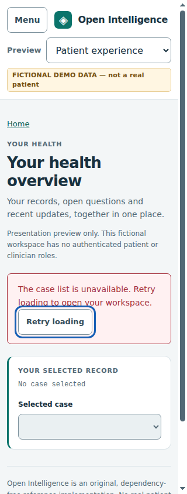

# Recoverable workspace startup

**Work package:** OI-010, Gate 2 of the existing UX convergence plan.

**Starting point:** PR #183 at `18c494fb998d1fe9878cce2ca730480f8ba60553`, on #166 at `334d863b2206b290c02cd2606dcb93c93afe3a68`.

## Problem and outcome

A failure of the first `/api/cases` read currently leaves Refresh list disabled and the canonical case-picker listener unbound. Empty, loading and failed startup all have no selected case, but require different explanations and next actions. The connected adapter currently infers an empty roster from heading strings. A second initialization after creation can also race an older startup read.

The user should be able to retry a failed initial read without reloading, retain the intended destination and entered setup fields, and reach the existing chart and intake workflow. A proven-empty workspace must remain refreshable so cases created elsewhere can be discovered. Creation that has already succeeded must not require another POST merely because the following list read failed.

## Chosen approach

Keep the existing initializer as the only owner that establishes initial selection. Add a small explicit startup phase and generation, representing request/presentation state rather than another case store. A globally visible status and native retry/refresh button remain available outside case views, including patient deep links and empty connected setup. The existing worklist refresh action delegates to initialization while no case has been selected.

Bind the existing picker handler once. New initialization generations supersede older roster and board work before they can change options, selection, errors or startup status. Preserve a newly created case as the intended initial selection. Build the worklist before enabling the initial chart, retaining the existing accepted-response projection guarantee.

The connected creation callback distinguishes ready, saved-but-unavailable and saved-with-canceled-activation outcomes. If loading fails, the creation status states that the workspace was saved and directs the user to retry. Retain that activation intent and complete the original source-intake navigation after a successful retry, without resubmitting creation. Capture the accepted-selection revision before the POST; a later accepted selection cancels obsolete activation intent, including a creation response delayed until after startup finishes. After initial selection, accepted worklist completion can resume the retained intent through the original picker handler. Only canonical chart readiness permits intake navigation.

### Alternatives considered

- Merely enable Refresh list: insufficient because the board reader deliberately does not establish canonical selection or its listener.
- Share only an in-flight initialization Promise: insufficient because creation can complete after that request captured an older roster.
- Disable all creation until startup succeeds: smaller concurrency surface, but blocks useful existing creation behavior during a transient read failure. Generation ownership preserves that behavior.

These are implementation decisions within the user's authorized continuation of the existing frontend scope. The live overlap audit found no equivalent startup repair in #192, #218, #232 or #246. H1 reading, patient attention and domain-summary expansion remain with their separate owners.

## Acceptance contract

1. Distinguish loading, unavailable, proven empty and available roster states. Neither a failed read nor a pending read may imply there are no cases.
2. Provide a visible, keyboard-operable retry outside all forms and case views. Pending attempts disable the action and expose loading state; failure remains recoverable without page reload.
3. Retry preserves the current route/presentation, search and entered setup fields. A successful retry clears only its own startup error, leaving unrelated notices intact.
4. Successful initial reads create unique picker options, select through the existing owner, and bind its handler exactly once. A later native case selection causes one canonical state read and retains all dirty-work/source protections.
5. An already established case owner cannot be reset by a repeated initializer or a late startup completion. It remains protected by `readyCase`, `refreshSequence` and the existing selection event.
6. An empty connected workspace offers creation and a reachable refresh action. Another session's created case can be discovered and opened.
7. Creation during a delayed initial read supersedes that older read. Its late success or error cannot replace the created case, append duplicate options or change the newer status.
8. If initial creation succeeds but its follow-up roster read fails, retain the saved creation and intended case. Retry activates it without another POST or misleading readiness claim.
9. Roster success remains distinct from selected-chart readiness. Preserve existing case-state failure/Open recovery and per-case summary error semantics.
10. Preserve all original form fields/validation, source bytes, backend/schema/API contracts, processing/review rules, dependencies and fictional fixtures. No polling, new endpoint or second record authority.

## Verification plan

Use real Chromium and the existing connected/standard launchers. Control selected GET outcomes before a fresh page load to produce HTTP/network/malformed/delayed reads; handoff tests also delay delivery of an actual successful creation POST response. All successful reads and writes use the real application and server. Read persisted state independently over HTTP. Exercise initial failure/retry, repeated failure, delayed loading, patient deep links, empty creation/discovery, creation/read races, saved creation followed by a failed read, unrelated notices, one native selection listener and retained unfinished work. Test a later trusted selection both during a creation POST and during the created chart read, then drain late responses and refresh the list to prove canceled intent stays canceled.

Record an actual failing baseline before changing runtime code. Run the complete existing Python, JavaScript and browser gates, including navigation, case continuity, scope recovery and worklist currentness. Preserve actual failures, fingerprints and exact-source hosted evidence. The final published run is recorded in #183 after the source snapshot is committed.

## Boundaries

This repairs first-load presentation and activation through the current reference owner. It does not change authentication, H1 ownership, backend mutation rules, clinical interpretation or deployment. Existing post-start mutation completion behavior and external-session currentness still follow the documented worklist contract. Verification uses independently authored fictional records.

## Implemented behavior

Runtime edits are confined to `web/app.js`, `web/index.html`, `web/workspace-entry.js` and the creation-status integration in `web/intake.js`. The added loading/retry section is outside all forms and case views. It remains visible from patient deep links, and its native button is disabled while a request is pending. A successful empty read retains an enabled refresh control after connected setup redirects. Unavailable startup no longer reports a fabricated zero-case count or exposes a raw request error.

The initializer has a generation and optional preferred created-case ID. It validates roster shape, deduplicates options, builds the original worklist, and checks ownership again before establishing the canonical case. A newer initialization invalidates an older initial board sweep. Once a case exists, ordinary initialization is a no-op; the existing chart refresh sequence and `readyCase()` still govern readiness. The original picker handler is bound once and preserves every unfinished-work and source-read guard.

Creation tracks presentation intent across its successful POST and follow-up reads. A selection revision captured before submission prevents a delayed response from replacing a later user choice. The initial path uses the initializer; the established-owner path uses the original full-worklist reader. Its accepted completion event signals roster membership, and the adapter attempts the original picker handler. Summary availability never establishes chart readiness. Only a ready matching chart completes source-intake navigation. Failed activation leaves saved/retry guidance, while canceled automatic activation acknowledges the save without obsolete retry instructions. Successful creation resets its form even if later activation fails, preventing the completed write from being presented as an unsubmitted form.

## Observed verification

| Check | Actual result |
|---|---|
| Missing-retry baseline on unchanged product runtime | [Run 41573359981](https://github.com/OpenxIntelligence/open-intelligence/actions/runs/41573359981), commit `05111c6825926a25b30590114433ba67c37d1a40`: 2 assertions, 1 passed and 1 intended failure. The first roster failed, no recovery control appeared, and the old notice echoed the controlled error. All four runtime fingerprints match the starting revision. |
| Independent-review handoff regressions before the correction | [Run 41574283236](https://github.com/OpenxIntelligence/open-intelligence/actions/runs/41574283236), commit `d88a456de47dec160d83a953f1cd634e026ea16a`: 51 of 55 assertions passed. Four intended failures demonstrated saved creation losing its status, unavailable/delayed chart loading announcing readiness, and a late creation response replacing a newer native case choice. |
| Complete focused startup journey after repair | [Run 41574710100](https://github.com/OpenxIntelligence/open-intelligence/actions/runs/41574710100), commit `f207a34c1abba7ed28bab69d298d4f09ccf50c76`: all **18 scenarios and 295 assertions passed**, with 19 screenshots and zero captured application JavaScript errors. |
| Local Python/HTTP regression suite | All **347 tests passed**, in 77.442 seconds. |
| Existing JavaScript suites after the final runtime correction | All **80 named tests across 8 files passed**. |
| Forms and protected source | All **16 original forms** retain their static controls and attributes; IDs remain unique within each served template. All 51 files under the recorded protected source/example/schema/fixture prefixes and the existing launcher are byte-identical to the starting revision. |
| Independent static assistant review | The startup/creation handoff finding was reproduced, corrected and re-reviewed. No remaining material blocker was found. Review was read-only and separate from browser execution. |

The focused suite covers HTTP, network and malformed first reads; repeated retry; loading; a patient deep link at 320px; native Tab reachability and trusted Enter activation; preserved worklist search; one trusted picker change and one canonical read; empty discovery; first creation and exact source-byte import; superseded initial roster success/error and initial board response; saved creation followed by failed loading; unrelated notices; repeated-initializer ownership; original Open recovery; startup completing during a delayed creation response; created-chart failure; and later native selection during both a POST and a chart read. The canceled-intent scenarios release and drain old responses before checking the final route/status, then refresh the list to prove canceled intent stays canceled.

### Preserved intermediate failures and harness corrections

- [Pre-flight run 41573486172](https://github.com/OpenxIntelligence/open-intelligence/actions/runs/41573486172) exposed a fragment-only test navigation that did not create a fresh document. The fault script never installed. A query parameter now forces a new document before startup is intercepted; the subsequent unchanged-runtime run produced the intended missing-retry failure.
- [Candidate run 41573809015](https://github.com/OpenxIntelligence/open-intelligence/actions/runs/41573809015) passed 155 of 160 assertions, including all non-keyboard recovery and race scenarios. The test's generic key helper emitted Enter keydown/keyup without the character needed for native button activation. The harness now sends the Enter character and records the resulting trusted keypress/click. The initial recovery scenario then passed in the handoff regression run, with unchanged product runtime for that correction.
- [Run 41574518438](https://github.com/OpenxIntelligence/open-intelligence/actions/runs/41574518438) passed 17 of 18 scenarios and 283 of 284 assertions. Its remaining test deliberately held Gamma's chart response but used a navigation helper that waited for that same chart to render. The test now waits for the available chart header/picker, performs the trusted Beta selection, and then retains the original visible-ready-chart assertions. The complete replay passed all 295 assertions with identical runtime fingerprints.

No browser flags, application readiness guards, original assertions or production dependencies were relaxed for these corrections. Reports, logs, representative failure screenshots and final screenshots remain in the execution archive.

### Integration and source identity

The main UI workflow adds the startup journey to every existing Python, JavaScript, browser, responsive navigation, case-continuity, scope-recovery and worklist gate. **Complete candidate integration passed:** [run 41574913060](https://github.com/OpenxIntelligence/open-intelligence/actions/runs/41574913060), at `e5b168f0b6a451e5bebde866cd39bf6092dfad9a`, completed every workflow step successfully. Its source tree is `8e29e10c71a8876e167241b68949ceca1271400c`. All 93 archived web/source/test files match the local candidate byte-for-byte, and all five recorded runtime fingerprints match. The downloaded [artifact](https://github.com/OpenxIntelligence/open-intelligence/actions/runs/41574913060/artifacts/13203850319) SHA-256 is `ad637a5983091ba97f9b19e07186ca5cac8dd218f141faa53f2801c343b62a39`.

The exact published revision's checked-out source tree, all runtime fingerprints and final hosted result are recorded in [PR #183](https://github.com/OpenxIntelligence/open-intelligence/pull/183), because that run is obtained after this source snapshot is committed. This avoids confusing the verification-only branch with the published draft revision.

The full candidate run passed 347 Python/HTTP tests, 80 JavaScript tests across eight files, all seven established browser journeys, 792 responsive navigation/form assertions across both launchers, 14 case-safety scenarios with 310 assertions, 68 scope/recovery assertions, 13 worklist scenarios with 387 assertions, and the 18 startup scenarios with 295 assertions. The navigation, case, scope, worklist and startup receipts contain zero captured application JavaScript errors.

[Machine-readable evidence](evidence/2026-11-02-workspace-startup-recovery.json) records source identities, run IDs and artifact digests. The [execution archive](evidence/2026-11-02-workspace-startup-recovery.zip) retains actual failure and success receipts, local suite output, static contract checks and review findings. Downloaded artifact SHA-256 values were checked before inspection. Hosted Chromium provides the browser evidence; the previously recorded local browser socket-policy restriction was respected, and no local browser pass is claimed.

## Remaining limits

This completes the first-start recovery gap recorded by the preceding worklist increment. It does not add continuous cross-session synchronization, polling or a new case authority. Other mutation-completion behavior retains its existing documented contract. The test data are independently authored fictional examples; the result does not establish authenticated roles, clinical qualification, a formal accessibility audit, cross-browser certification, live-provider integration or deployment. The PR remains a draft stacked on #166.

### Recovery from a patient deep link at 320px

